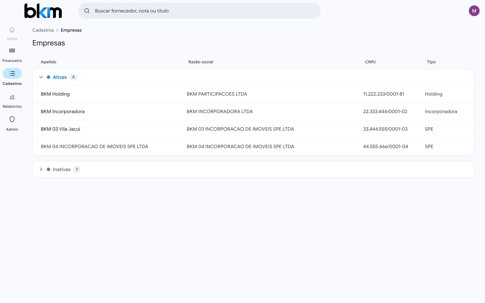
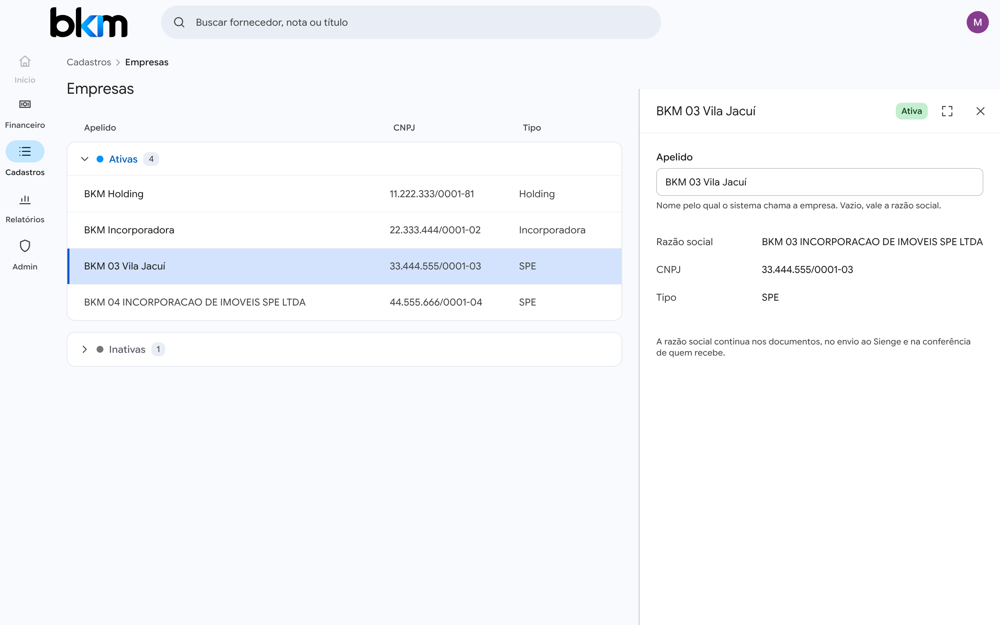
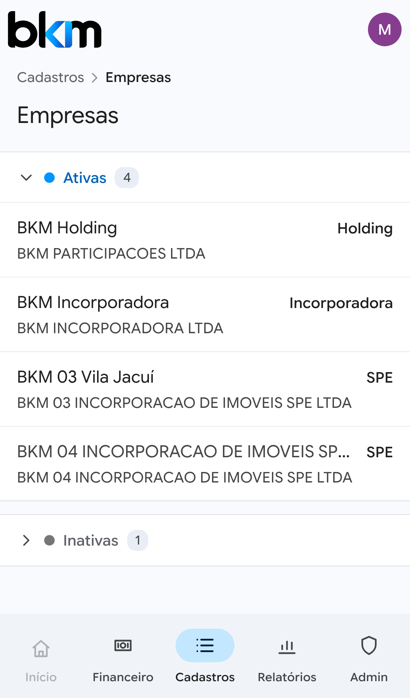
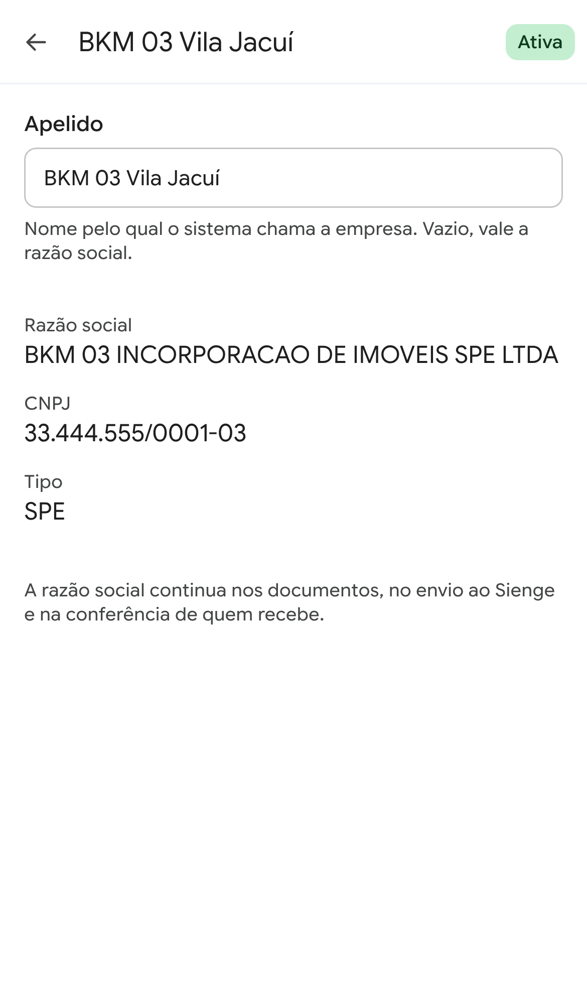

# Empresas, sócios e empreendimentos

[← Sumário](../README.md)

## Como o grupo está organizado

✅ **Decidido** (Moises, 7/nov/2026):

- Todo empreendimento tem a sua SPE, sempre um para um.
- Acima da SPE estão os sócios dela: a BKM e, às vezes, outro sócio que responde por uma parte.
- Acima das empresas está a holding (o grupo).

No sistema isso fica assim:

| Cadastro | O que guarda | Regra |
| --- | --- | --- |
| **Empresas** | Holding, BKM Incorporadora e cada SPE, cada uma com seu CNPJ | ✅ Uma lista só para todas. Não existe cadastro separado de "holding": a holding é a empresa que não tem dono dentro do grupo. |
| **Participações** | Quem é sócio de qual empresa, com o percentual, de quando até quando | ✅ A soma dos percentuais vigentes de uma empresa é 100%. Mudar o percentual encerra a linha antiga e abre uma nova, para guardar o histórico. |
| **Empreendimentos** | O produto: nome, SPE, praça, terreno de origem (BKM Terrenos) | ✅ Separado da SPE, mesmo sendo um para um. A SPE é o CNPJ; o empreendimento é o negócio. |
| **Praças e regionais** | Lista fixa | 🟡 Campo com lista, não etiqueta livre (ver abaixo). |
| **Núcleos econômicos** | Um por SPE ou empreendimento, mais o Corporativo (e uma loja, por exemplo) | ✅ Nunca um núcleo por tipo de gasto. Os centros de custo (Marketing, Obra...) ficam dentro do núcleo. Ver [Classificação](../financeiro/classificacao.md). |
| **Etiquetas (tags)** | Agrupamentos livres, como "lançamento 2027" | Para o que não precisa de garantia. |

### Praça e regional: lista, não etiqueta

O Moises sugeriu que praça e regional pudessem ser etiquetas (7/nov/2026). 🟡 A proposta do desenho é que sejam **campos com lista fixa**, porque etiqueta aceita erro de digitação e duplicidade ("SP" e "São Paulo"), e praça serve para relatório, orçamento consolidado e permissão de acesso. Etiquetas ficam para o resto. Falta confirmação explícita.

### Atributos do empreendimento para relatórios

✅ **Decidido** (7/nov/2026): cidade, estado, regional, praça, linha de produto, faixa MCMV e outros atributos ficam **no cadastro do empreendimento**, e não repetidos em cada lançamento. Os relatórios enxergam esses campos como se estivessem em cada linha. A lista de atributos pode crescer: o administrador cria novos. Quando um atributo muda (por exemplo, a faixa MCMV), o sistema guarda a data, para que um relatório do passado mostre o valor da época.

---

✅ **A Muchmore fica fora do ERP** (Moises, 15/nov/2026). Ela é a empresa 1 do Sienge, com os centros SSG, SSB e FCA. Não vira núcleo econômico e o histórico dela não é trazido do Sienge.

## Apelido da empresa

✅ **Pedido do Moises** (23/nov/2026): cada empresa do grupo pode ter um **apelido**, o nome pelo qual o sistema a chama, além da razão social. É como um nome fantasia só para uso interno.

🟡 Como ficou no PR #120, ainda não juntado:

- O apelido é opcional, tem de 2 a 40 letras e não se repete entre as empresas. Também não pode ser igual à razão social nem ao nome fantasia de outra empresa do grupo, sem contar maiúsculas. Se for, o sistema avisa "O apelido … é o nome de outra empresa do grupo".
- ✅ O master, a AF, a AD e o administrador dão ou mudam o apelido (Moises, 23/nov/2026). 🟡 No PR #120, a mudança vale na hora para todos, inclusive o administrador, e fica no histórico. ⏳ Falta o Moises dizer se a mudança feita pelo administrador passa por aprovação, como manda a regra geral do TI de 14/nov.
- ✅ As SPEs começam com o apelido **SPE 0X**, onde X é o número de cada uma: SPE 01 a SPE 08 (Moises, 23/nov/2026). Algumas levam também o nome do empreendimento depois do número, como "SPE 0X - Nome do empreendimento". A BKM Incorporadora e Construtora S.A. fica com o apelido **Matriz**.
- As telas de Títulos, Previsões, Contas recorrentes, Para aprovar, Lançar título e Nova conta mostram o apelido. Empresa sem apelido aparece pela razão social.
- A razão social continua nos documentos, no envio ao Sienge e na conferência de quem recebe o pagamento.

### Tarefa: dar ou mudar o apelido de uma empresa

**Quem faz:** master, AF, AD ou administrador (⏳ a do administrador talvez passe por aprovação).

1. Abra **Cadastros › Empresas**. A lista mostra apelido, razão social, CNPJ e tipo, das empresas ativas e inativas.
2. Toque na empresa. Abre uma gaveta ao lado.
3. Digite o apelido no campo **Apelido**. Ele grava quando você sai do campo ou aperta Enter. Esc volta ao que estava.
4. Para tirar o apelido, apague o campo e saia dele.

## Tarefa: cadastrar uma nova SPE e seu empreendimento

> ⏳ As telas ainda não existem. O roteiro abaixo segue as regras decididas.

**Para que serve:** criar a empresa e o produto de um novo negócio, normalmente quando um terreno é comprado no BKM Terrenos.

**Quem faz:** administrador do cadastro. ⏳ O papel exato será definido na sessão de aprovações.

**Antes de começar:** o CNPJ da SPE; os sócios e os percentuais; no Sienge, a empresa e a obra já criadas (a API do Sienge não cria empresa nem obra).

**Passo a passo:**

1. Abra **Cadastros › Empresas** e clique em **Nova empresa**.
2. Informe CNPJ, razão social e o tipo **SPE**.
3. Em **Sócios**, inclua cada sócio (empresa do grupo ou pessoa de fora) com o percentual e a data de início. O total precisa dar 100%.
4. Salve. Abra **Cadastros › Empreendimentos** e clique em **Novo empreendimento**.
5. Escolha a SPE que acabou de criar, dê o nome, escolha a praça e, se veio do BKM Terrenos, ligue o terreno de origem.
6. Preencha os atributos (cidade, linha de produto, faixa MCMV...).
7. Ligue a empresa e a obra correspondentes do Sienge (uma vez só).
8. Salve. O núcleo econômico do empreendimento é criado junto, com os centros de custo que valem para ele já ligados.

**O que o sistema confere:** CNPJ válido e não repetido; soma dos sócios igual a 100%; uma SPE com um empreendimento só.

**E depois?** O empreendimento já pode receber orçamento, compromissos e títulos. Se a viabilidade veio do BKM Terrenos, ela vira a primeira versão do orçamento.

## Tarefa: mudar a participação de um sócio

**Passo a passo:**

1. Abra a empresa e vá em **Sócios**.
2. Na linha do sócio, clique em **Alterar participação**.
3. Informe o novo percentual e a data a partir da qual vale.
4. Ajuste os outros sócios para que a soma continue 100% na mesma data.
5. Salve. A linha antiga fica encerrada na véspera e continua no histórico.

**O que o sistema confere:** a soma de 100% em qualquer data; datas sem buraco nem sobreposição para o mesmo sócio.
