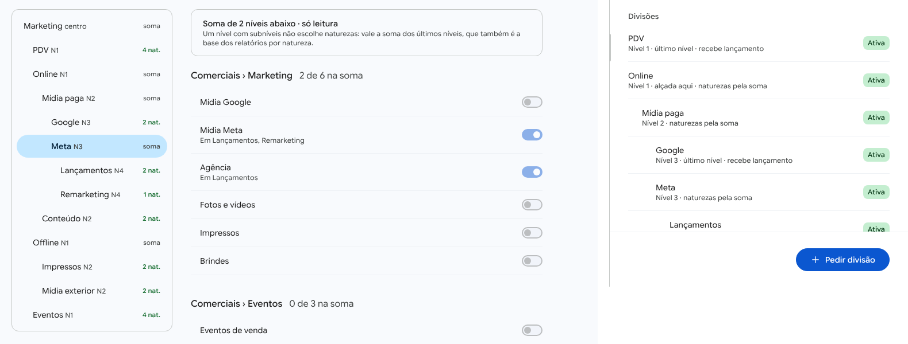

# Como todo valor é classificado

[← Sumário](../README.md)

## As cinco perguntas

✅ **Decidido** (7/nov/2026). Todo valor do sistema (orçamento, previsão, título, pagamento) responde às mesmas cinco perguntas, cada uma com um campo próprio:

| Pergunta | Campo | Exemplo |
| --- | --- | --- |
| De quem é o gasto? | Empresa e núcleo econômico | SPE Vila Maria / núcleo Vila Maria |
| Onde ele é apropriado? | Centro de custo | Marketing |
| O que se comprou? | Natureza | Mídia paga › Google |
| Quando? | Competência e data de caixa | competência out/2027, pago em nov/2027 |

> ⚠️ **Nomes trocados em 14/nov/2026** (Moises). O que este manual chamava de **centro de custo** (a obra, o Corporativo) agora é **núcleo econômico**. O que chamava de **área** (Marketing, Comercial, Administrativo) agora é **centro de custo**. As regras não mudaram com a troca. No Sienge, "centro de custo" continua sendo a obra, ou seja, o nosso núcleo econômico. Cuidado na transição.

### O que muda em relação a hoje

Hoje a BKM usa no Sienge "centro de custo Marketing, natureza MKT Online, motivo verba Google", com cerca de 9 centros de custo por SPE. No ERP BKM:

| Hoje no Sienge | No ERP BKM |
| --- | --- |
| Centro de custo: a obra, ou uma obra fingida para a área administrativa | Núcleo econômico: a SPE ou a obra, o Corporativo, uma loja |
| Centro de custo: Marketing (um por SPE) | Centro de custo: Marketing, da lista única, ligado no núcleo |
| Natureza: MKT Online | Natureza: só o que se comprou, por exemplo **Mídia paga online**; quem gastou é o centro de custo e a divisão |
| Motivo: verba de mídia Google | Mais um nível da natureza (… › Mídia Google) **ou** só a descrição do lançamento |

**Regra para decidir se o "motivo" vira nível da natureza:** se você quer orçar e comparar por ele ("quanto previ e quanto gastei de Google no ano"), ele é um nível. Se só explica aquele gasto ("campanha de março"), ele vai na descrição.

**Por que os centros de custo são uma lista única:** com 30 empreendimentos e 10 centros cada, seriam 300 cadastros, e cada regra ou relatório teria de listar os que entram. Com uma lista única ligada nos núcleos, "marketing da empresa inteira", "marketing do Vila Maria" e "tudo o que o Marketing gastou" viram filtros sobre os mesmos dados.

## Três dimensões: núcleo econômico, centro de custo e natureza

✅ **Decidido** (Moises, 14/nov/2026, renomeando e ajustando o que foi decidido em 8/nov/2026). Cada lançamento leva três classificações separadas:

- **Núcleo econômico:** de quem é o gasto. É **a SPE ou a obra**, o **Corporativo** (escritório central, holding, novos negócios antes de virar SPE) ou outro negócio, como uma **loja**. Os núcleos ficam numa árvore **estado › cidade › região › núcleo**, e **cada núcleo está num lugar só** da árvore (senão os relatórios somariam em dobro). O tipo de produto é um filtro do relatório, não um nível da árvore.
- **Centro de custo:** onde a despesa é apropriada dentro do núcleo, por exemplo **Marketing, Terreno, Incorporação, Obra, Assistência técnica, Administrativo**. Todos os centros de custo ficam numa **lista única (raiz)** da empresa, e cada um é **ligado ou desligado em cada núcleo**: o Corporativo não tem Obra nem Pós-obra; uma loja não tem Incorporação. Cada centro de custo tem **aprovadores escolhidos pelo nome** e diz **quantos deles precisam aprovar**.
- **Natureza:** o plano de contas, só o que se comprou (Mídia paga, Vigilância, Energia...). ✅ A natureza **não leva o nome da área**: quem gastou é dito pelo centro de custo e pela divisão (Moises, 15/nov/2026).

**O centro de custo precisa estar ligado no núcleo**, senão o lançamento é recusado. 🟡 Quem liga e desliga: no banco já construído, só o administrador (regra técnica ainda sem confirmação do Moises).

**Travas, alçadas e aprovações** podem ser dadas em qualquer das três dimensões. Também se pode **liberar ou bloquear cada pessoa para lançar** em cada uma delas.

✅ **Não há etapa do empreendimento** (Moises, 15/nov/2026). A etapa (Terreno, Incorporação, Obra...) saiu do sistema porque se confundia com o centro de custo. O momento do gasto é dito só pelo **centro de custo** e pela **divisão**.

✅ **Divisão** é a subdivisão de um centro de custo, por exemplo Marketing › PDV, Online, Offline e Eventos. Decisões do Moises de 15/nov/2026 (no código a partir do PR #41):

- O administrador só **pede** para criar, renomear ou desativar uma divisão. A mudança vale quando os aprovadores de acesso aprovam; o pedido do master vale na hora. Quem tem acesso ao centro não aprova. Divisão não se apaga.
- Com divisão ativa no centro, **toda linha de rateio, previsão e orçamento precisa dizer a divisão**.
- **Acesso:** pode descer até a divisão. O modelo dá todas as divisões (inclusive as futuras, menos as excluídas) ou uma lista (com as futuras, se marcado). Cada divisão incluída pode ter nível próprio. A exceção da pessoa na divisão vence a do centro. Quem tem só algumas divisões não vê a linha do centro sem divisão.
- **Alçada:** a divisão pode ter faixas próprias, com o acumulado só da divisão. Cada faixa diz se aprova só na divisão ou se passa também pelo centro, cujo acumulado soma o centro inteiro. Divisão sem faixas segue o centro. Na alçada da divisão, o gestor da área é o gestor do centro, e o responsável da divisão entra como vaga nominal. Quem tem vaga na alçada da divisão e na do centro **aprova uma vez só**, e a aprovação vale pelas duas; em sequência, ela entra no centro quando chegar a vez dele lá. Entre duas divisões, uma aprovação não vale pela outra (Moises, 15/nov/2026).
- ✅ **Naturezas da divisão** (Moises, 15/nov/2026; no código a partir do PR #46): ao criar a divisão, escolhem-se as naturezas em que se pode lançar nela. Dá para marcar todas, desmarcar todas ou escolher uma a uma. Depois, o master, o administrador e o AF, o AO e o AD ligam e desligam cada natureza na hora, sem aprovação, e toda mudança fica registrada. No centro sem divisão vale a lista do próprio centro. No centro com divisões vale a lista de cada divisão. Natureza nova nasce desligada em todas as divisões. Não se desliga uma natureza numa divisão, ou num centro, enquanto houver **compromisso ativo** com linha nela ali (contrato, pedido, assinatura, compra avulsa, guia ou folha): antes é preciso reclassificar esses compromissos, e ao tentar desligar o sistema mostra quais, com o tipo de cada um. Compromisso encerrado não impede. Títulos e notas já lançados seguem normalmente; desligar só impede lançar nela ou trocar para ela daí em diante. O administrador (TI) também muda na hora, como exceção à regra de que as mudanças dele passam por aprovação (confirmado pelo Moises, 15/nov/2026). **Modelos de naturezas:** são listas prontas, por exemplo "Marketing online". Ao criar uma divisão, ou ao ajustar uma que já existe, aplica-se um modelo e as naturezas dele ficam marcadas de uma vez; depois dá para ajustar uma a uma. Quem cria e muda modelos são os mesmos que ligam as naturezas: master, administrador, AF, AO e AD. Tudo fica registrado.
- ✅ **Subníveis da divisão** (Moises, 15/nov/2026; no código a partir do PR #48): a divisão pode ter até 4 níveis abaixo do centro (Divisão Nível 1 a 4), por exemplo Marketing › Mídia › Online › Google. Só se lança no último nível. Se uma divisão ganha subníveis, o lançamento novo exige o subnível, e o que já estava na divisão fica onde está. Acesso, alçada e o carimbo do pagamento e do adiantamento ficam na divisão de primeiro nível e não descem. O rateio de um título pode se dividir entre subníveis. Um nível com subníveis ativos não se desativa.
- ✅ **Naturezas de cada nível** (Moises, 15/nov/2026; no código a partir do PR #48): os níveis se chamam **Divisão Nível 1, 2, 3 e 4**. Só o último nível de cada galho tem lista própria de naturezas. O centro e todo nível que tem níveis abaixo **não têm naturezas próprias**: mostram, só para leitura, a soma das naturezas de todos os níveis abaixo deles, para dar o relatório por natureza no centro e em cada divisão. Ao criar um nível, a escolha das naturezas é obrigatória, de uma destas formas:
  - à mão, uma a uma, com Marcar todas e Desmarcar todas;
  - por um **modelo salvo** (a escolha feita também pode ser salva como modelo);
  - **copiando de um nível irmão**;
  - no primeiro nível abaixo de outro, copiando a lista do nível de cima.

  Master, administrador, AF, AO e AD mudam as naturezas na hora. A antiga forma "vinculada ao nível de cima" não existe mais (Moises, 15/nov/2026). O primeiro nível criado abaixo de outro pode copiar a lista desse nível de cima; daí em diante, o de cima deixa de ter lista própria. Não se cria esse primeiro nível se ele não cobrir as naturezas dos compromissos ativos que ficaram no nível de cima: o envio fica bloqueado e a tela lista cada compromisso com o tipo. Desligar uma natureza continua barrado enquanto houver compromisso ativo nela, inclusive um antigo que ficou num nível acima. Entram nessa trava todos os compromissos ativos: contrato, pedido, assinatura, compra avulsa, guia e folha.

  

✅ **Etiquetas** (Moises, 15/nov/2026; no código a partir do PR #48): etiquetas nos títulos, por exemplo o nome de uma campanha, servem para filtrar e para relatórios. Não entram em aprovação, alçada nem acesso. Quem lança põe no título uma das etiquetas que existem. 🟡 **Só a AF, a AD e o master** criam, renomeiam e desativam etiquetas; quem lança só escolhe entre as que existem e estão ativas (Moises, 15/nov/2026; código no PR #53, ainda não juntado). Renomear muda o nome em todos os títulos. Etiqueta desativada sai da escolha, mas continua nos títulos que já a têm. Na tela aprovada (15/nov/2026), **Etiquetas** fica no Admin, só para a AF, a AD e o master, e mostra quantos títulos usam cada etiqueta. O nome não se repete. Etiqueta não se apaga, só se desativa.

✅ Para não confundir: cada passo de uma aprovação (gestor, AF, AD) se chama **fase de aprovação** (Moises, 15/nov/2026).

**Mover um núcleo de lugar na árvore, ou ligar e desligar um centro de custo num núcleo, exige aprovação** e fica registrado, porque muda quem vê e quem aprova. (A aprovação de ligar e desligar é 🟡 proposta, por extensão da regra de 8/nov.)

Hoje o Sienge tem 97 centros de custo, que misturam obra, tipo de gasto e momento. Eles viram cerca de 25 núcleos econômicos na árvore, mais a lista de centros de custo. ⏳ O de-para com o Sienge está em rascunho. Enquanto os títulos forem criados lá, cada combinação núcleo × centro de custo × natureza tem de apontar para exatamente uma conta e um centro de custo (obra) do Sienge, senão o título não sobe. ✅ Na transição, quem lança escolhe a natureza no ERP, e o sistema sabe em que conta e em que centro de custo do Sienge lançar (Moises, 15/nov/2026). ✅ **Todo o passado do Sienge entra no ERP**, sem exceção de período ou de tipo de registro ("cada vírgula do passado da empresa", Moises, 15/nov/2026), menos a Muchmore, que fica fora do ERP (ver [Empresas e empreendimentos](../cadastros/empresas-e-empreendimentos.md)). A forma da carga ainda está sendo desenhada.

## A árvore de naturezas

✅ **Decidido** (7/nov/2026):

- **Uma árvore só** para a empresa inteira, com quantos níveis cada galho precisar.
- **O topo da árvore é o mesmo da viabilidade do BKM Terrenos** (Terreno, Obras, Comerciais, Gerais, Financeiras, Taxas...), para que viabilidade, orçamento e realizado se comparem sem conversão.
- **A árvore é dinâmica:** novas naturezas são criadas pela tela, sem programador (Moises, 7/nov/2026).
- **O topo também é editável** (Moises, no documento do modelo v1: "concordo, mas tem que ser editável"). Isso substitui a proposta de travar o topo.
- **A árvore é feita do zero**, não copiada do plano financeiro do Sienge (Moises, 7/nov/2026). O plano do Sienge fica ligado a ela por correspondência, por trás.

🟡 **Propostas** ainda sem confirmação:

- Só o administrador (ou o controller) cria naturezas, para não surgir "MKT Online", "Marketing online" e "Mkt digital" lado a lado.
- Só se lança no último nível (não se lança em "Comerciais", só em "Mídia paga online").
- A natureza nova herda as características da mãe (ver abaixo), e pode ser mudada.
- Natureza com lançamentos não se apaga direto: primeiro se reclassifica (ver [Reclassificação](reclassificacao-e-fechamento.md)).
- Natureza desativada não recebe lançamentos novos; os antigos continuam onde estão.
- Mover um galho com lançamentos para outra mãe mostra antes quanto do histórico muda de lugar.
- Mudar o lugar, o tipo, a linha da DRE ou a do fluxo de caixa de uma natureza que já tem lançamentos é só com a diretoria, porque mexe nos relatórios do passado.
- Como o topo é editável: quem edita o topo e o que acontece com a comparação com a viabilidade quando ele muda. ⏳

### Características de cada natureza

✅ **Decidido** (7/nov/2026): a classificação contábil-gerencial é **característica da natureza**, não uma escolha a cada lançamento. Quem lança escolhe só "Mídia Google", e o sistema já sabe o resto.

| Característica | Valores |
| --- | --- |
| Tipo | despesa do período (cai na linha da DRE do centro de custo), receita, dedução, financeira, IR e CSLL, investimento (CAPEX, fora da DRE), movimentação (fora da DRE) ou custo do empreendimento (entra no POC) |
| Linha da DRE | receita, dedução, custo, despesa comercial... |
| Linha do fluxo de caixa | operacional, investimento, financiamento |
| Redutora | sim ou não (devolução, estorno, desconto obtido) |

✅ **Toda DRE é por POC** (percentual de obra concluída), e cada natureza tem um dos tipos acima (Moises, 15/nov/2026). Isso substitui a lista antiga de tipos (operacional, não operacional, movimentação).

**Movimentação não é despesa:** transferência entre contas próprias, aplicação, resgate, aporte e distribuição entre sócios mexem no saldo do banco, mas ficam fora da DRE.

**Regra:** se uma mesma natureza às vezes é operacional e às vezes não, na verdade são duas naturezas.

### A carga inicial da árvore

🟡 Existe um rascunho (v0) com 11 grupos e cerca de 45 galhos no [documento do modelo v1](https://claude.ai/artifact/YXuHgVNLaMPRtpxJ8YWCPt). ⏳ Quatro pontos em que ele difere da viabilidade atual aguardam decisão do Moises:

1. Impostos sobre a receita passam de Financeiras para Deduções.
2. Custo de capital fica só no orçado, porque nunca vira pagamento.
3. Taxas de gestão entre empresas do grupo viram um par de lançamentos (despesa numa, receita na outra).
4. ITBI e registro das unidades vendidas vão para Comerciais › Custos de repasse.

## Rateio

✅ **Decidido** (7/nov/2026): um gasto que serve a vários núcleos, centros de custo ou naturezas (campanha institucional, aluguel da sede) é dividido em percentuais. Cada parte conta para o seu núcleo e o seu centro de custo.

## Agrupamentos, móveis, consórcio, empreendimento beneficiado e PDV

Decisões do Moises de 16/nov/2026, ainda sem código. O detalhe está no [plano de naturezas](https://claude.ai/artifact/PvD4oxEJHpjEpWJU2b6DFD).

- ✅ **Pessoal, Contas de consumo e Imóveis, móveis, veículos e equipamentos são agrupamentos de naturezas, não centros de custo.** O salário da analista de Marketing é natureza Salários no centro Marketing; assim o custo fica com quem o gerou.
- ✅ **Móvel tem três naturezas, conforme onde fica:**
  - **Mobiliário e decoração do PDV**: despesa comercial do empreendimento, fora do POC;
  - **Mobiliário e decoração das áreas comuns**: Obra, entra no POC;
  - **Móveis para uso próprio**: investimento (ativo), o que fica com a BKM.
- ✅ **Consórcio é um centro de custo** da holding (núcleo Corporativo), com tudo dentro: parcelas, venda da carta, intermediação e impostos. A divisão é o empreendimento e o nível abaixo é a carta. Cada carta é cadastrada com administradora, grupo, cota, crédito, empreendimento beneficiado e financiamento da Caixa; a divisão é escolhida uma vez, e as parcelas nascem com ela.
- ✅ **Empreendimento beneficiado**, em dois modos:
  - **Só gestão**: o custo fica na empresa que pagou e só aponta o empreendimento (caso do consórcio);
  - **A reembolsar**: o custo é da SPE. O sistema gera a conta a pagar da SPE para a holding, com a natureza original, e mostra o saldo a reembolsar de cada SPE, com aviso de atraso.
- ✅ **PDV** é cadastrado com as SPEs que atende e o percentual fixo de cada uma, por vigência. Todo título do PDV se divide sozinho, e pode cair em mais de uma SPE. A natureza "Custo fixo de PDV" deixa de existir.

🟡 A conferir: hoje uma nota não se rateia entre empresas, porque tem um só tomador. Pela leitura do plano, o PDV de várias SPEs funciona pelo modo "a reembolsar": a holding paga e cada SPE devolve a sua parte. Ainda falta confirmar.

⏳ Para o contador: o reembolso pelo custo exato fica fora da receita da holding? Qual o prazo máximo do saldo antes de virar mútuo (com IOF)? Precisa de contrato de compartilhamento de despesas por escrito?

## Tarefa: criar uma natureza nova

> ⏳ As telas ainda não existem.

1. Abra **Configurações › Naturezas**.
2. Encontre na árvore o galho onde a nova natureza vai ficar e clique em **Adicionar dentro**.
3. Dê o nome. Antes de salvar, confira na árvore se não existe outra com o mesmo sentido.
4. Confira o tipo, a linha da DRE e a do fluxo de caixa, que vêm da mãe. Mude só se for diferente.
5. Salve. A natureza já aparece para lançamento e para orçamento.

## Tarefa: lançar um gasto com rateio

1. No lançamento (nota, previsão ou orçamento), em **Classificação**, clique em **Ratear**.
2. Inclua uma linha por parte: núcleo econômico, centro de custo, natureza e percentual.
3. Confira que a soma dá 100%.
4. Salve. Cada parte aparece no relatório do seu núcleo e do seu centro de custo.
