# Contas a pagar: do compromisso ao pagamento

[← Sumário](../README.md)

## O caminho de um gasto

✅ **Decidido** (7/nov/2026). Todo gasto passa por até cinco etapas, e cada uma tem o seu lugar no sistema. **A dívida só existe a partir do título.** Antes disso, o que há é expectativa.

```
Compromisso  →  Previsão  →  Documento  →  Título (parcelas)  →  Pagamento e baixa
(o acordo)      (o esperado)  (a nota)      (a dívida)            (o dinheiro que saiu)
```

| Etapa | O que é | Exemplo |
| --- | --- | --- |
| **Compromisso** | O acordo que vai gerar gasto | Contrato com a empreiteira; assinatura da internet; pedido de compra |
| **Previsão** | O gasto esperado, que ainda não é dívida | "Internet de março, cerca de R$ 400" |
| **Documento** | A nota, o boleto ou a guia que chegou | NFS-e 112 da empreiteira |
| **Título** | A dívida real, com uma ou mais parcelas | Título de R$ 9.000 em 3 parcelas |
| **Pagamento** | O dinheiro que saiu do banco | Pix de R$ 3.000 em 10/03 |

### Tipos de compromisso

✅ As origens de gasto são poucas: **contrato**, **pedido de compra**, **assinatura recorrente**, **despesa avulsa**, **guia de imposto** e **folha**. O que é variado (marketing, limpeza de terreno, vigilância, material de escritório...) é a **natureza** do gasto, que é classificação, não um tipo novo de cadastro. Ver [Classificação](classificacao.md).

✅ A **assinatura recorrente** substitui o contrato fictício de hoje: ela tem periodicidade e valor estimado por período, e gera sozinha uma previsão para cada vencimento.

### Previsão não é título

✅ **Decidido** (Moises, 14/nov/2026, trocando a decisão de 6 e 7/nov): a previsão nasce no ERP BKM e, **aprovada, vai ao Sienge como título de previsão (PRV)**, sem forma de pagamento, para abastecer o fluxo de caixa de lá. Ela nunca vira o título de verdade: um título criado pela API não pode ter tipo, número nem valor alterados depois (teste no Sienge em 6/nov/2026). Por isso, quando a nota chega, o título definitivo é criado à parte e o PRV vai para a lista de títulos a apagar à mão no Sienge (ver [Previsões de despesa na transição](#previsões-de-despesa-na-transição)). A previsão de natureza PJ não vai ao Sienge.

Quando a nota chega e o título nasce, ele **consome** a previsão correspondente, e a diferença entre o previsto e o realizado fica registrada. Uma previsão pode ser editada (volta para aprovação) ou cancelada e substituída por outra (Moises, 14/nov/2026).

✅ A nota só consome a previsão que casa com ela: **mesma empresa, mesmo fornecedor, mesmo núcleo econômico, mesmo centro de custo e mesma natureza** (trava autorizada pelo Moises, 14/nov/2026). A previsão **sem fornecedor** (a do orçamento de área, ou a lançada à mão sem fornecedor) pode ser consumida por nota de qualquer fornecedor, desde que empresa, núcleo, centro e natureza casem.

## Primeira etapa da implantação: o pedido de pagamento

✅ **Decidido** (Moises, 8/nov/2026):

- **A obra fica fora** desta etapa. Os demais departamentos usam o ERP BKM do compromisso até a chegada da nota.
- Quando a nota chega, quem a recebe cria no ERP BKM o **pedido de pagamento**, subindo a nota e o título. O ERP BKM guarda tudo.
- O ERP BKM **cria o título no Sienge** pela API, e o pagamento segue no Sienge até o fim.
- Depois, o ERP BKM **lê no Sienge o que aconteceu** com o título e guarda.
- **Conferência:** uma rotina do sistema confere se todos os títulos do ERP BKM chegaram mesmo ao Sienge. No começo, uma pessoa também confere à mão.
- **Relatório para cada pessoa:** cada um recebe a lista dos títulos que cadastrou e que foram ao Sienge, para conferir se foi tudo.

> ⚠️ **Passo manual no Sienge:** a autorização, o pagamento e o lote (remessa pelo Nexxera) continuam feitos no Sienge. Ver [O que ainda é feito à mão no Sienge](../transversais/passos-manuais-no-sienge.md).

✅ Também confirmado (Moises, 8/nov/2026):

- **O título vai ao Sienge pela API, nunca redigitado**, já com a nota anexada, os impostos e o PIX ou o boleto. O ERP BKM guarda o número de cada título no Sienge.
- **Pré-requisito:** enquanto os títulos passarem pelo Sienge, o pedido de pagamento só se conclui no ERP BKM com **todas as informações de pagamento** (PIX, conta ou boleto) preenchidas e aprovadas. Só então o título é criado no Sienge, já completo.
- **A conferência vai nos dois sentidos:** aponta o título do ERP BKM que não chegou ao Sienge, o título criado direto no Sienge fora do fluxo e o título mudado no Sienge depois de criado (valor, conta, PIX).
- O relatório para cada pessoa fica, mas pode sair quando a conferência à mão confirmar que o sistema não erra.

Teste de 8/nov/2026 (título 8422): o título criado pela API aceitou o PIX depois de criado, e a API aceita os impostos já na criação.

#### Forma de pagamento e envio ao Sienge (PR #71)

✅ Código no PR #71, juntado. As regras de boleto e PIX foram aprovadas pelo Moises em 17/nov/2026.

- **Forma de pagamento de cada parcela:** quem lança a nota diz como cada parcela vai ser paga, por PIX (com o tipo e a chave) ou por boleto (com a linha digitável). O sistema confere a chave e os dígitos do boleto.
- **Trava:** depois do primeiro voto da alçada, ou com o título já na fila do Sienge, ninguém muda mais a forma de pagamento, nem quem lançou. Ela só volta a mudar na revisão do título.
- **Boleto** (Moises, 17/nov/2026): o valor impresso na linha digitável tem que ser o da parcela. Boleto sem valor impresso (zero) é aceito.
- **PIX por CPF ou CNPJ** (Moises, 17/nov/2026): a chave tem que ser o documento do credor do título. A chave de outra pessoa só entra com uma justificativa, que aparece para quem aprova.
- **Avisos em cada parcela, para quem aprova:**
  - "A chave não é do documento do credor", para chave de e-mail, telefone ou aleatória;
  - "Chave CPF/CNPJ de outra pessoa", seguido da justificativa;
  - "Chave nova para este credor". Uma chave é nova quando nunca foi usada num título desse credor que já foi para o Sienge.
- **Aviso crítico de chave nova:** quando o título aprovado vai ao Sienge com uma chave nova, o master e a lista AF recebem um aviso crítico. Esse aviso não se desliga, nem no sino nem no e-mail.
- **Envio automático:** o título aprovado vai sozinho ao Sienge, já com a forma de pagamento. A situação do envio aparece no título: pendente, enviado, erro ou manual.
- **Divisão em parcelas:** o valor se divide em partes iguais, e o centavo que sobra fica na primeira parcela, como o Sienge faz. Antes ficava na última.
- **Limite desta primeira versão:** nota com retenção ou caução ainda não vai ao Sienge.

### Previsões de despesa na transição

✅ **Decidido** (Moises, 14/nov/2026, depois dos comentários do diretor financeiro). O módulo de Orçamentos fica para depois. Enquanto isso:

- Cada centro de custo (Marketing, Comercial...) lança no ERP BKM as **previsões de despesa** (a projeção dos títulos que vão vir).
- O ERP BKM cria cada previsão no Sienge como **título de previsão**, pela API, para abastecer o fluxo de caixa do Sienge. Assim não é preciso uma tela de fluxo de caixa no ERP BKM agora.
- **Cada título de previsão do Sienge fica ligado à previsão do ERP BKM.**
- Quando a nota chega, o pedido de pagamento cria no Sienge o título definitivo, e a previsão é dada como **substituída**. A previsão também pode ser **excluída** no ERP BKM.
- Nos dois casos, o ERP BKM avisa o financeiro qual título de previsão apagar no Sienge, numa **página** com esses títulos (no lugar da planilha do Google; Moises, 18/nov/2026).

> ⚠️ **Passo manual no Sienge:** apagar o título de previsão que foi substituído ou excluído. A API não apaga título, e o título criado por ela só aceita mudar o vencimento e o PIX (testes de 6 e 8/nov/2026). Ver [O que ainda é feito à mão no Sienge](../transversais/passos-manuais-no-sienge.md).

✅ Também decidido (Moises, 14/nov/2026):

- O título de previsão vai ao Sienge **sem forma de pagamento**, só como previsão, para não ser pago por engano.
- **O Sienge é monitorado:** a leitura diária aponta os títulos de previsão que deveriam ter sido apagados e continuam lá, com aviso também por **e-mail**.
- **Quando o Sienge é verificado:** a cada 30 minutos no horário comercial, mais uma conferência completa de madrugada. Motivo: o limite de 200 consultas por minuto da API do Sienge é dividido com o CRM (Moises, 14/nov/2026, 14h35).
- **Página das PRV a apagar** (Moises, 18/nov/2026, no lugar da planilha do Google): abre com **qualquer conta Google da BKM** (@bkm.com.br), mesmo de quem não tem usuário no ERP BKM; ninguém de fora entra. Quem abre vê **todas** as PRV a apagar, de todas as empresas e centros, sem as permissões do ERP BKM (confirmado pelo Moises, 18/nov/2026, 9h53). Mostra empresa, número do título no Sienge, documento (PRV-…), valor, data prevista, desde quando está na lista, a última conferência e a situação da previsão. A página **se atualiza sozinha**: o título apagado no Sienge some dela em segundos, sem F5 (Moises, 18/nov/2026). No Sienge, busque pelo **número do título** (no campo Título) ou pelo **documento PRV-…**; o número do título não é o número do documento.
- **A página é só de leitura.** Ninguém marca "apagado": o próprio ERP BKM confere o Sienge e a linha some da página sozinha quando o título foi de fato apagado (Moises, 14/nov/2026, 14h32). Quando o Sienge avisa a exclusão, isso leva segundos; senão, a conferência a cada 30 minutos marca.
- **Ninguém inclui nem tira linha à mão:** a lista vem direto do ERP BKM a cada abertura (e a cada 5 minutos, com a página aberta). Por isso a defesa da planilha contra linha incluída à mão deixou de ser necessária.
- Se sumir do Sienge um título que **não estava na lista**, a leitura diária avisa a **AF**.

✅ **A previsão aprovada é o pedido** (Moises, 14/nov/2026, respondendo ao diretor financeiro). A previsão passa pelas mesmas regras de aprovação do pedido de pagamento e é a autorização para contratar o serviço ou fazer a compra, antes da nota. Não se chama "pedido de compra", porque não passa por suprimentos, mas faz o mesmo papel. A nota que chega sem previsão aprovada pede uma aprovação a mais (a AD, por padrão), salvo a **verba livre** do centro de custo.

✅ **Verba livre, sem previsão** (Moises, 14/nov/2026): cada centro de custo pode receber nota sem previsão aprovada até dois limites configuráveis: um **valor por nota** e um **acumulado no mês**. Acima de qualquer dos dois, a nota pede a aprovação a mais. (O diretor financeiro sugeriu R$ 5 mil por mês para o Marketing.) 🟡 Proposta ainda sem confirmação: o acumulado também por fornecedor, para que ninguém pique uma compra grande em várias notas pequenas.

✅ **Travas de data da nota** (Moises, 14/nov/2026):

- Nota de serviço não se lança fora das **datas permitidas** (por exemplo, do dia 25 ao 30, quando a contabilidade confere as retenções e emite as guias). As datas são **editáveis**.
- Nota **emitida antes da previsão aprovada** é travada, porque senão a aprovação vira só uma etapa formal.
- A **AF** ou a **AD** podem abrir exceção, com motivo.

#### Contratos recorrentes e previsões no código (PR #72)

✅ Código no PR #72, juntado:

- **Aprovação do contrato recorrente e da assinatura:** aprovam o gestor do centro e alguém da AF ou da AO. Quem criou ou alterou o contrato não aprova. Mudar valores, datas, credor ou rateio pede aprovação de novo.
- **Previsões do contrato** nascem aprovadas quando o contrato é aprovado. A previsão lançada à mão passa pela alçada do título.
- **Nota menor que a previsão:** quem lança escolhe entre duas opções:
  - **Saldo:** nasce outra previsão com o valor que sobrou, na data que a pessoa informar (hoje ou depois);
  - **Saving:** a previsão só é encerrada.
- **Previsão no Sienge:** a previsão aprovada vai ao Sienge como título PRV, sem forma de pagamento. Quando ela deixa de estar aberta, a linha entra na lista para o financeiro apagar no Sienge. O sistema marca a linha sozinho quando o título some de lá.
- **Marcação do apagado (PR #76, ainda não ligado):** quando o financeiro apaga o título PRV no Sienge, o ERP marca a linha em poucos minutos, pelo aviso do Sienge; sem o aviso, em até 30 minutos. Se o título apagado era de uma previsão ainda aberta, o ERP cria outro no Sienge.

🟡 Propostas ainda sem confirmação do Moises:

- **Previsão vencida sem nota** há X dias aparece numa lista para quem lançou, que reprograma ou cancela com motivo.
- A previsão nasce com os mesmos campos da futura linha de orçamento (núcleo econômico, centro de custo, natureza, mês e valor, com fornecedor opcional), para virar o histórico do módulo de Orçamentos sem retrabalho.

⏳ Em discussão: tirar no Sienge a permissão de criar e alterar títulos e dados bancários dos departamentos que entrarem no ERP BKM, para fechar a brecha de pagar fora do fluxo. O custo é que um lançamento urgente passa a depender do ERP BKM.

### As telas do pedido de pagamento

> 🧪 **Protótipo escolhido, ainda sem código** (Moises, 8/nov/2026: "linha F"). Os nomes abaixo são os do protótipo e podem mudar até a tela existir. Regra do Moises para todas as telas: bastante área branca, muito respiro.

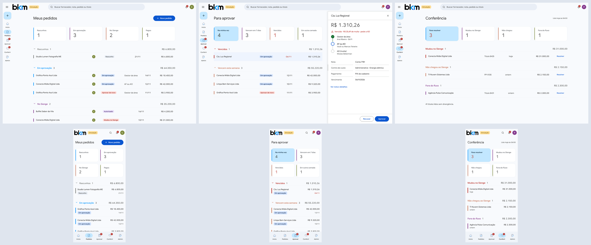

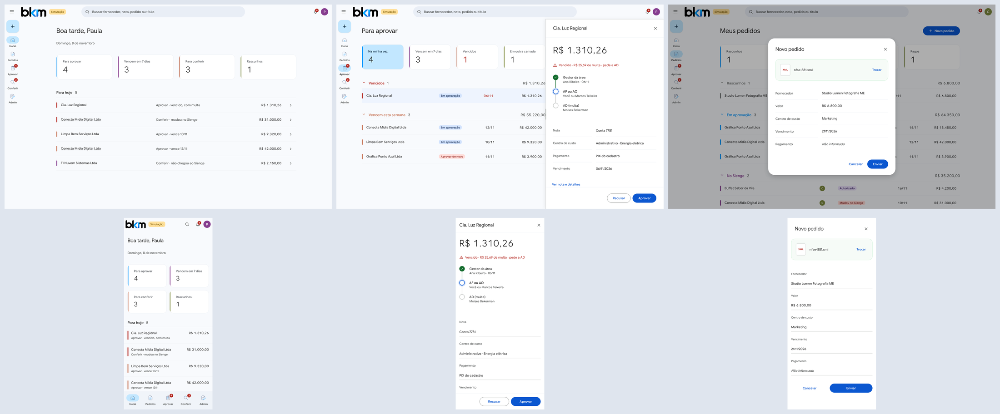

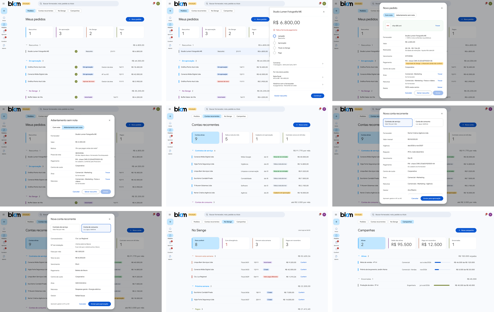

#### Consultar títulos, previsões e contas recorrentes (PR #85)

✅ **Primeira tela de verdade, no PR #85, juntado.** Ela só consulta; as telas de lançar vêm nos próximos PRs. O pedido do Moises, de 18/nov/2026, foi começar pelas telas de lançar título, previsões e contratos recorrentes, e pela de consultar.

**Entrada:** pela conta Google @bkm.com.br. Quem não tem cadastro no ERP vê "Sem acesso ao ERP".

**Menu Pedidos**, com três abas:

1. **Títulos**
   - **Contadores:** Rascunhos, Em aprovação, No Sienge e Pagos. Um clique filtra, e o segundo clique volta a mostrar tudo.
   - **Grupos:** os títulos ficam agrupados, com o total de cada grupo. Os cancelados ficam num grupo fechado, no fim.
   - **Etapas:** Rascunho, Em revisão, Recusado, Em aprovação, Aprovado, No Sienge, Não chegou ao Sienge, Pago e Cancelado.
   - **Gaveta:** clicar na linha abre a gaveta do título. No topo vêm o valor, as etiquetas e os avisos: a recusa (quem recusou e por quê), o erro no envio e "Esperando …". Depois vêm os dados (fornecedor, documento, emissão, competência, empresa, número no Sienge e quem lançou), as parcelas com o PIX ou o boleto e onde o gasto entra (o rateio). Por último aparecem as retenções e a caução, as previsões consumidas e os votos.
2. **Previsões**
   - **Contadores:** Esperando aprovação, Abertas, Consumidas e Encerradas ou canceladas.
   - **Saldo:** a previsão aberta mostra quanto ainda resta.
   - **Gaveta:** data, competência, fornecedor ("Sem fornecedor" quando falta), onde entra, natureza, núcleo, origem, contrato e número no Sienge.
   - ✅ **Nova previsão** (pedido do Moises, 25/nov/2026; PR #142, juntado em 25/nov): o botão no alto da aba, só para quem lança, abre uma janela que pede empresa, fornecedor (opcional), competência e data prevista, valor, descrição e onde entra (núcleo, centro, divisão do último nível e natureza). A previsão nasce **Esperando aprovação**; aprovada, vai ao Sienge como PRV e espera a nota que vai consumi-la. Natureza PJ: só o master e os designados lançam, o master aprova e ela não vai ao Sienge (a janela avisa). 🟡 Proposta da equipe, ainda não confirmada pelo Moises: **previsão sem fornecedor exige descrição**, que vira o nome dela na lista e no Sienge (sem ela, apareceria só "Sem fornecedor").

     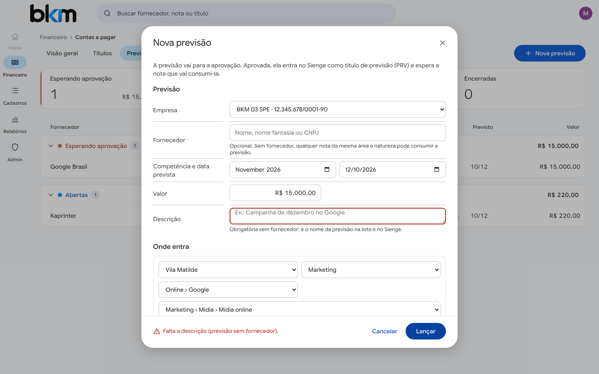

     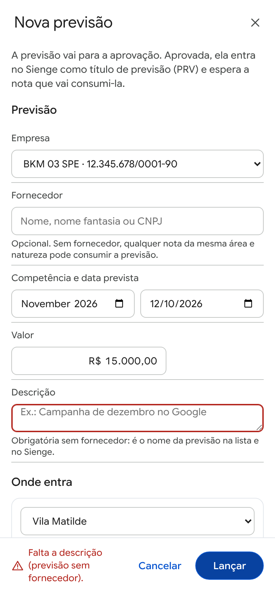
3. **Contas recorrentes**
   - **Contadores:** Ativas, Em aprovação, Vencem em 60 dias e Encerradas.
   - **Grupos:** Contratos de serviço e Assinaturas, com o total por mês. A conta de consumo ainda não existe no banco.

**Nas três abas:**
- A busca na barra de cima procura fornecedor, nota ou número.
- O link copiado abre a mesma tela, com o filtro aplicado.
- Título e previsão de PJ só aparecem para o master e para quem ele designou.

✅ **Revisão visual no PR #90, juntado.** As regras não mudam; muda o visual:
- as abas ficam no lugar do título da página;
- os contadores mostram o total em R$;
- o cabeçalho das colunas fica fixo;
- os grupos viram quadros;
- a gaveta empurra a lista em vez de cobri-la, e no celular ocupa a tela inteira, com uma seta de voltar;
- a lista vazia ganha o botão "Limpar filtro e busca";
- o contador "Encerradas ou canceladas" passa a se chamar "Encerradas".

O #90 também traz a navegação nova (Moises, 18/nov/2026):
- **Menu em três níveis.** O menu lateral mostra os módulos: Início, Financeiro, Cadastros, Relatórios e Admin. Parar o mouse sobre um módulo abre uma gaveta com os submódulos; parar sobre um submódulo abre outra gaveta com as páginas. Em Financeiro › Contas a pagar, as páginas são Visão geral, Títulos, Previsões e Contas recorrentes. O que ainda não existe aparece apagado, com "Em breve". No alto da página ficam a trilha ("Financeiro › Contas a pagar") e as abas.
- **Visão geral de Contas a pagar**, a página que abre primeiro. No topo ficam quatro números:
  - quanto há a pagar nos próximos 7 dias;
  - quanto venceu sem pagamento;
  - quantos títulos e previsões esperam aprovação;
  - quanto as contas recorrentes somam por mês.

  Embaixo vem um cartão por seção, que explica o que se encontra nela e o que dá para fazer.

✅ **Rastro do título, no PR #91** (juntado). A gaveta do título ganha uma barra com 7 botões, e cada um abre uma janela:
- **Origem:** o documento que veio antes do título e o título que ele substituiu.
- **Aprovações:** todas as rodadas de aprovação.
- **Alterações:** os pedidos de revisão com a resposta, e o antes e depois de cada ajuste.
- **Histórico:** a linha do tempo do título.
- **Anexos:** vazio por ora, com o botão marcado "em breve".
- **Contrato:** valor, lançado, pago, saldo e os títulos do contrato. Só aparece quando o título vem de um contrato.
- **Fornecedor:** o cadastro, os números e os últimos títulos. Conta só os títulos que a pessoa pode ver.

As seções Previsões consumidas e Aprovação saem da gaveta e passam para essas janelas.

As imagens abaixo são as do PR #85 e serão trocadas quando o #90 for juntado.

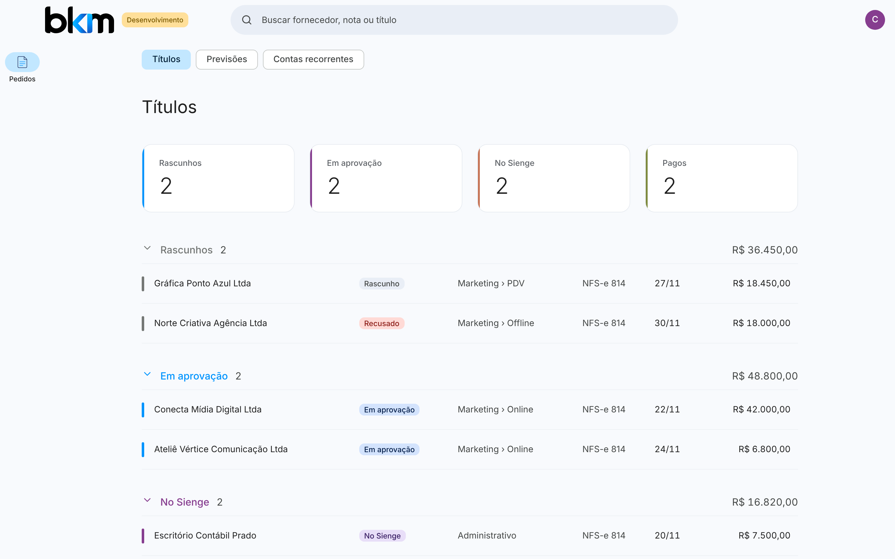

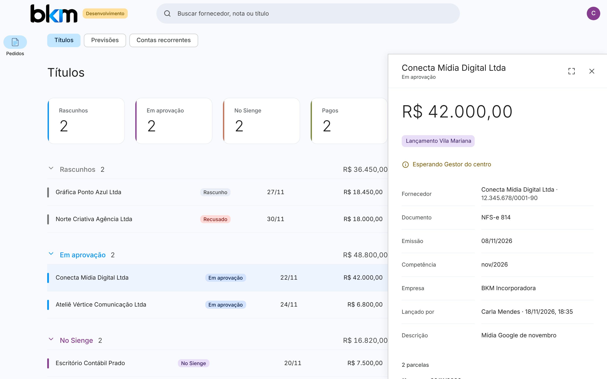

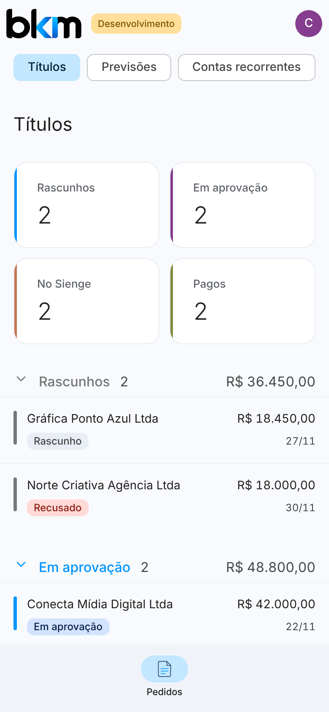

#### O que muda nas telas com o piloto do Marketing

> ✅ Telas aprovadas pelo Moises em 15/nov/2026 (protótipo, versão 35), ainda sem código. As imagens são de versões um pouco anteriores.

- **Novo pedido:** tem o campo **divisão**. Ele é obrigatório quando o centro de custo tem divisões. O pedido pode ser **rateado** entre centros: cada centro aprova a sua parte, com a alçada dele, e o título só segue quando todos aprovarem. O pedido também pode **abater um adiantamento** em aberto. Se o adiantamento é de outra divisão do mesmo centro, o abatimento pede o gestor do centro ou AF, AO ou AD. Se é de outro centro, pede AF, AO ou AD.
- **Para aprovar:** a ficha do pedido mostra um quadro por alçada, com cada vaga e quem já aprovou. Quando a divisão "passa pelo centro", uma aprovação vale para os dois. Quando faltam aprovadores, aparece o aviso de que o pedido foi ao master, com o motivo.
- **Adiantamentos (aba nova em Pedidos):** os adiantamentos em aberto e os abatimentos para aprovar, com núcleo, centro e divisão de cada um.
- **No Sienge:** o centro aparece com a divisão (por exemplo, Marketing › Online).

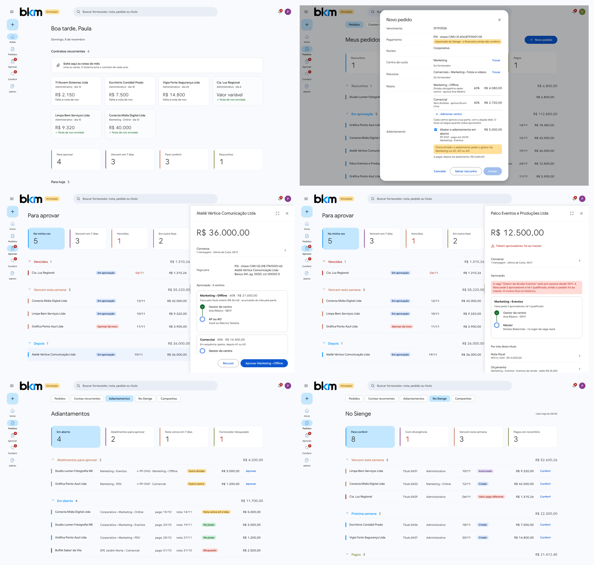

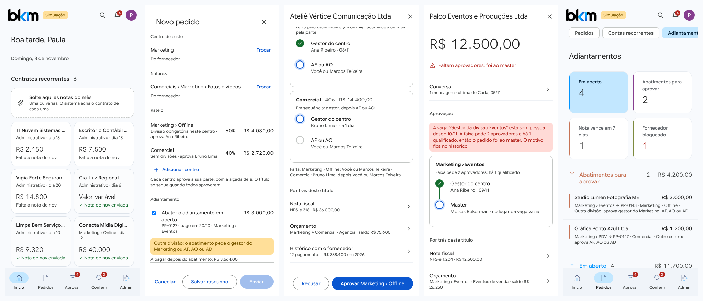

O menu tem cinco itens: **Início**, **Pedidos**, **Aprovar**, **Conferir** e **Admin**. No celular, eles ficam numa barra embaixo.

| Tela | O que mostra |
| --- | --- |
| **Início** | No alto, os **Contratos recorrentes**: a caixa única **Solte aqui as notas do mês** (várias notas de uma vez) e, abaixo, uma caixa por contrato, para soltar a nota de um só; depois quatro contadores (Para aprovar, Vencem em 7 dias, Para conferir, Rascunhos) e a lista **Para hoje**, com o que você precisa fazer hoje |
| **Pedidos** | Quatro abas no alto: **Pedidos**, **Contas recorrentes**, **No Sienge** e **Campanhas**. A aba Pedidos é **Meus pedidos**: contadores Rascunhos, Em aprovação, No Sienge e Pagos, e os pedidos agrupados por situação, com a soma de cada grupo |
| **Ficha do pedido** | Abre ao clicar num pedido seu: as etapas **Lançado › Aprovação › Título no Sienge › Pago**, o aviso do que falta (por exemplo, "Falta a forma de pagamento"), a conversa, o que está por trás (nota, histórico com o fornecedor) e as ações da situação: **Excluir rascunho** e **Continuar**, **Cancelar** ou **Enviar de novo** |
| **Contas recorrentes** (aba de Pedidos) | Contadores Contas ativas, Falta a nota do mês, Cadastro em aprovação e Contrato vence em 60 dias; as contas agrupadas em Contratos de serviço e Contas de consumo; botão **Nova conta** |
| **No Sienge** (aba de Pedidos) | Os títulos que você lançou e que estão no Sienge, por vencimento (Vencem esta semana, Próxima semana, Pagos), com a situação lida do Sienge e **Conferir** em cada um; contadores Para conferir, Com divergência, Vencem esta semana e Pagos no mês |
| **Campanhas** (aba de Pedidos) | As campanhas de remuneração variável com orçado, usado e saldo. 🟡 Ainda a confirmar |
| **Novo pedido** | Uma janela com duas opções no alto: **Com nota** e **Adiantamento sem nota**. Com nota, você sobe o XML e ela preenche fornecedor, valor, retenções (com o líquido), vencimento, pagamento, núcleo econômico, centro de custo e natureza, e mostra o rateio |
| **Para aprovar** | Contadores Na minha vez, Vencem em 7 dias, Vencidos e Em outra camada; os pedidos agrupados por prazo |
| **Conferência** | O que o sistema achou ao comparar com o Sienge: **Mudou no Sienge**, **Não chegou** e **Fora do fluxo**, cada um com **Resolver** |

### Contas recorrentes: os dois tipos

> ✅ Decidido pelo Moises, 8/nov/2026: as contas recorrentes entram já na primeira etapa da implantação. Contratos de obra ficam para o módulo de Suprimentos.

Conta recorrente é a que se repete todo mês. Ela fica cadastrada uma vez e ganha uma caixa no **Início**. Há dois tipos:

| Tipo | Exemplos | O que o cadastro guarda |
| --- | --- | --- |
| **Contrato de serviço** | software, contabilidade, vigilância, limpeza, mídia | fornecedor, empresa pagadora, valor mensal, vigência, reajuste, dia de vencimento, dados de pagamento (PIX, conta ou boleto), núcleo econômico, centro de custo, natureza, gestor e o PDF do contrato |
| **Conta de consumo** | energia, água, telefone | média esperada por mês (o valor médio da fatura, não um máximo), teto no ano e o número da instalação ou do cliente (é ele que identifica a fatura quando a concessionária usa um CNPJ só para todas as contas) |

**Aprovação do cadastro:** cada conta recorrente é aprovada pelo gestor de cada centro e por alguém da AF ou da AD antes de valer (Moises, 23/nov/2026; antes AF ou AO). **Trocar PIX, conta, valor ou média esperada exige nova aprovação.**

### Tarefa: cadastrar uma conta recorrente

> ✅ **Tela no PR #96**, juntado. Os passos numerados mais abaixo seguem o protótipo (linha F).

**Como fica no PR #96:**

1. Em Financeiro › Contas a pagar › Contas recorrentes, clique em **Nova conta** e escolha um de três tipos:
   - **Assinatura:** valor por mês ou por período;
   - **Contrato de serviço:** valor total;
   - **Conta de consumo:** concessionária, número da instalação (como está na fatura), **média esperada por mês** (o valor médio da fatura, não um máximo; Moises, 20/nov/2026), teto no ano e dia do vencimento. No PR #97 (juntado), o dia passa a ser opcional, com o aviso "Na conta de consumo, a fatura que chega preenche e atualiza o dia"; mudar o dia não abre versão nova da conta.
2. Preencha empresa, fornecedor, descrição, vigência, vencimento e o rateio, como no Lançar título.
3. Clique em **Enviar para aprovação**. Aprovam o gestor de cada área e alguém da AF ou da AO.

**Para mudar uma conta ativa:** use **Alterar**, na gaveta da conta. O botão só aparece para quem lança naquela conta. O tipo não muda, e mudar valor, vigência, fornecedor, instalação ou rateio manda a conta de novo para aprovação.

**Na lista**, as contas de consumo ganham um grupo próprio, com "média R$ X por mês".

**Quem aprova a nota de cada mês:** ver **Quem aprova a nota do mês**, mais abaixo nesta página.

**Como era no protótipo (linha F):**

1. Abra **Pedidos**, aba **Contas recorrentes**, e clique em **Nova conta**.
2. Escolha o tipo: **Contrato de serviço** (valor fixo por mês) ou **Conta de consumo** (luz, água, telefone).
3. Preencha:
   - **Contrato de serviço:** fornecedor, valor mensal, vigência, reajuste (por exemplo, "IPCA, todo dezembro"), dia de vencimento, pagamento (vem do cadastro do fornecedor), núcleo econômico, centro de custo, natureza, gestor e o PDF do contrato;
   - **Conta de consumo:** concessionária, número da instalação (como está na fatura; é por ele que o sistema acha a fatura), média esperada por mês, teto no ano, vencimento, pagamento (por exemplo, boleto da fatura), núcleo econômico, centro de custo, natureza e gestor.
   - **Previsão mês a mês** (opcional; contrato com data de fim, assinatura mensal ou conta de consumo): o botão **Prever mês a mês** abre um quadro com um campo por mês da vigência (sem data de fim, 12 meses a partir do início ou do mês de hoje; depois do último mês, a previsão segue com o valor dele). No contrato, a soma dos meses tem de dar o valor do contrato: se não der, o sistema pergunta qual ajustar, **Ajustar o contrato** para a soma ou **Ajustar o calendário** para o valor (a diferença vai para os meses que ainda mudam, na proporção de cada um). Na conta de consumo, os meses de cada ano não passam do teto no ano, e a fatura de cada mês é comparada com a previsão daquele mês (não com a média), quando a conferência da fatura entrar. **Voltar ao valor igual** apaga o calendário (Moises, 23/nov/2026).
   - **Como paga** (opcional): **PIX fixo** (a mesma chave todo mês), **TED** (banco, agência, conta com o dígito, corrente ou poupança, e o CPF ou CNPJ do titular) ou **Vem com cada cobrança** (o boleto ou o PIX copia e cola chega com a nota de cada mês; se vier de outro jeito, a AF escolhe). ✅ No sistema (PRs #137 e #140, juntados em 24/nov): em **Lançar título**, cada parcela escolhe **PIX**, **Boleto**, **TED** (banco, agência, conta com o dígito, corrente ou poupança, e o CPF ou CNPJ do titular) ou **Do cadastro**, que aparece quando a nota consome previsões de uma conta com PIX fixo ou TED já aprovados e usa a forma cadastrada (se o cadastro da forma está esperando aprovação, a tela avisa e é preciso informar a forma desta cobrança). Quando a cobrança chega com outra forma, a gaveta do título e a de **Para aprovar** mostram o quadro **Forma de pagamento** com o aviso, e quem é da AF (ou da AD, ou o master) vê o botão **Usar a forma do cadastro**, ou aprova com a forma que veio; a troca fica registrada e aparece para quem aprova depois. Quem lançou não escolhe. A TED vai ao Sienge. A chave CPF/CNPJ e a conta da TED têm de ser do fornecedor; de outra pessoa, só com a justificativa, que quem aprova vê (Moises, 23/nov/2026).
   - No fim, a lista **Pronto para gerar títulos** mostra o que falta para a nota do mês virar título sem pedir mais nada: fornecedor, empresa, onde entra somando 100%, valor, dia do vencimento (na conta de consumo, vem na fatura) e como paga. Não é obrigatório: dá para enviar e completar depois.
4. Clique em **Enviar para aprovação**. Aprovam o gestor e alguém da AF ou da AD. Enquanto isso, a conta aparece com a marca **Cadastro em aprovação**.

**Se precisar mudar:** trocar a forma de pagamento (PIX, TED, conta), valor, média esperada ou um mês do calendário manda a conta de novo para aprovação. Depois de aprovada, mês que já passou não muda.


> 🧪 Telas em protótipo (linha F), ainda sem código. Pedido do Moises, 8/nov/2026.

**Para que serve:** mandar a nota mensal de um contrato fixo (software, contabilidade, vigilância, energia...) quase sem digitar, porque o contrato já tem os dados. São os compromissos do tipo [assinatura recorrente](#tipos-de-compromisso).

**Quem faz:** quem recebe a nota do contrato.

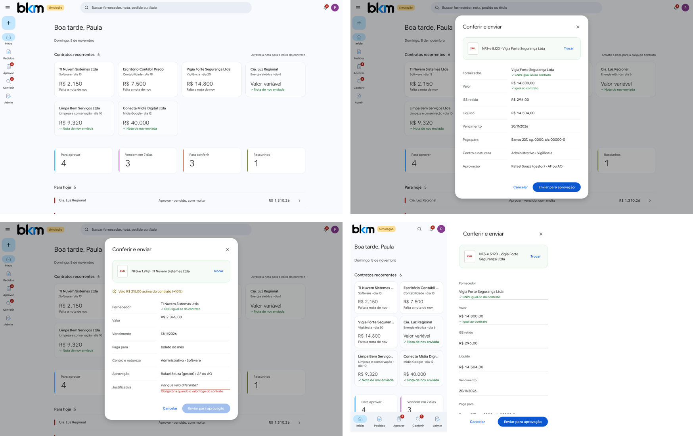

**Passo a passo:**

1. Abra o **Início**. No alto, a seção **Contratos recorrentes** mostra uma caixa por contrato: fornecedor, natureza, dia, valor mensal (ou "Valor variável") e a situação da nota do mês ("Falta a nota de nov" ou "Nota de nov enviada").
2. **Arraste o arquivo XML da nota para a caixa do contrato.** No celular, ou se preferir, toque na caixa e solte a nota no campo que aparece.
3. Abre a janela **Conferir e enviar**, já preenchida pela nota e pelo contrato: fornecedor, valor, retenções (por exemplo, ISS), líquido, vencimento, para onde paga (PIX, conta ou boleto), centro e natureza, e as camadas de aprovação.
4. Confira. Se o valor veio diferente do contrato, aparece o aviso (por exemplo, "Veio R$ 215,00 acima do contrato (+10%)") e é preciso escrever a **justificativa**.
5. Clique em **Enviar para aprovação**.

**O que o sistema confere** (regra do Moises, 8/nov/2026, no documento dos diretores), antes de montar o pedido:

- o CNPJ de quem emitiu a nota é o do fornecedor da conta;
- quem recebe a nota (o tomador) é a empresa pagadora certa;
- o contrato está vigente;
- o mês ainda não tem nota (não deixa mandar a nota duas vezes);
- o valor cabe na regra: no contrato de serviço, o valor mensal com os reajustes aprovados; na conta de consumo, até X% acima da previsão daquele mês (começa em 30%) e dentro do teto do ano.

O que não bate vira **exceção**: o pedido só segue com justificativa. Na tela, as marcas "CNPJ igual ao do contrato" e "igual ao contrato" aparecem embaixo do fornecedor e do valor.

**Quem não pode aprovar esse pedido:** quem arrastou a nota e quem mexeu por último no cadastro da conta.

✅ **Quem aprova a nota do mês** (Moises, 23/nov/2026): com a conta aprovada, a nota segue só o rito dela, não as faixas do centro. Está no sistema (PR #135, juntado em 24/nov/2026).

- **Contrato de serviço e assinatura:** o gestor do centro (confere que o serviço foi prestado) e depois a AF ou a AD.
- **Conta de consumo:** se as faturas do mês (esta mais as que já entraram no mesmo mês) ficam até 30% acima da previsão daquele mês e o ano continua dentro do teto, vai direto a alguém da AF, da AO ou da AD. Acima disso, o gestor do centro aprova primeiro. O percentual muda nas configurações.
- ✅ A nota segue as faixas normais do centro quando a conta ainda não foi aprovada, quando a nota entra num centro, divisão ou natureza fora do cadastro, quando o contrato ou a assinatura vem acima do valor previsto para o mês (somando as notas do mesmo mês), ou quando a nota é de um mês fora da vigência da conta (Moises, 24/nov/2026: acima da previsão do mês volta às faixas; a tolerância é só do consumo).
- A nota continua contando no total do mês do centro, que decide a aprovação das outras despesas.

### Tarefa: enviar várias notas do mês de uma vez

> 🧪 Telas em protótipo (linha F), ainda sem código. Pedido do Moises, 8/nov/2026.

**Para que serve:** no começo do mês, mandar todas as notas dos contratos recorrentes de uma só vez, sem procurar a caixa de cada contrato.

**Quem faz:** quem recebe as notas dos contratos.

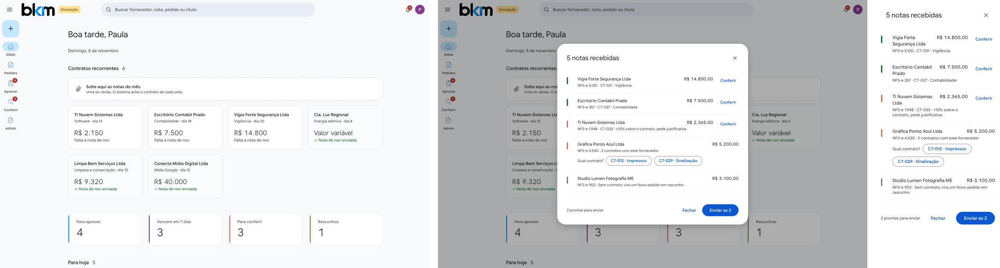

**Passo a passo:**

1. Abra o **Início**. Em **Contratos recorrentes**, acima das caixas dos contratos, fica a caixa **Solte aqui as notas do mês**.
2. **Arraste todos os arquivos XML das notas para essa caixa**, de uma vez. No celular, toque na caixa e escolha os arquivos.
3. O sistema acha o contrato de cada nota pelo CNPJ de quem emitiu e de quem recebe a nota (a BKM). Se o mesmo fornecedor tem mais de um contrato, ele tenta desempatar pelo serviço, pelo texto da nota e pelo valor.
4. Abre a janela **N notas recebidas**, com uma linha por nota, em quatro situações:
   - **Pronta** (faixa verde): bate com o contrato. Pode ir direto.
   - **Com divergência** (faixa laranja), por exemplo "+10% sobre o contrato": clique em **Conferir** e escreva a justificativa.
   - **Dúvida entre contratos** (faixa laranja): o sistema mostra "Qual contrato?" com os contratos possíveis. Clique no certo.
   - **Sem contrato** (faixa cinza): a nota não é de nenhum contrato recorrente e vira um **Novo pedido em rascunho**, para você completar em [criar um pedido de pagamento](#tarefa-criar-um-pedido-de-pagamento).
5. Clique em **Enviar as N**. Vão para aprovação **só as prontas**; as outras ficam na janela até você resolver (as sem contrato ficam em Rascunhos).

**O que você não pode fazer:** enviar uma nota com divergência sem justificativa, nem uma nota com dúvida entre contratos sem escolher o contrato.

> ⏳ Depende de teste: a nota também pode casar com um **pedido de compra aprovado** (por exemplo, "Pedido de compra 4.512 · saldo R$ 6.400,00, fica R$ 2.560,00"). Nota parcial abate do saldo e o pedido continua aberto. Isso só vale na primeira etapa se a consulta de pedidos de compra do Sienge (GET /purchase-orders) funcionar no teste; senão, entra só com o módulo de Compras.

> 🟡 Proposta ainda não decidida pelo Moises: receber notas pelo **WhatsApp**. O WhatsApp só recebe a nota; o sistema responde com um resumo e um link, e o envio é feito no aplicativo, com login. Só números cadastrados seriam aceitos, e PDF sem XML ganharia o selo "conferência manual".

### Tarefa: criar um pedido de pagamento

> 🧪 Telas em protótipo (linha F), ainda sem código.

**Para que serve:** levar uma nota que chegou até o pagamento no Sienge, passando pelas aprovações.

**Quem faz:** quem recebeu a nota, em qualquer departamento fora a obra.

**Passo a passo:**

1. No menu, abra **Pedidos** (ou use o **+** no alto do menu) e clique em **Novo pedido**.
2. Deixe marcado **Com nota** e suba o arquivo XML da nota. O sistema preenche:
   - **Fornecedor**, com a marca de que o CNPJ e a nota foram conferidos na prefeitura;
   - **Valor** e **Retenções**: os impostos retidos vêm da tabela de retenções, com o **líquido** a pagar (por exemplo, "ISS 2% · R$ 136,00 · líquido R$ 6.664,00");
   - **Vencimento** e **Pagamento** (PIX, conta ou boleto);
   - **Núcleo econômico**, **Centro de custo** e **Natureza**, cada um num campo separado (ver [as três dimensões](classificacao.md#três-dimensões-núcleo-econômico-centro-de-custo-e-natureza)). Centro de custo e natureza vêm do cadastro do fornecedor;
   - **Rateio**: "100% neste centro", ou **Ratear** para dividir.
3. Confira cada campo e complete o que faltar, principalmente o **pagamento** (PIX, conta ou boleto). **Sem os dados de pagamento completos, o pedido não se conclui.**
4. Clique em **Enviar**. O pedido aparece em **Meus pedidos**, no grupo Em aprovação.

Sem os dados de pagamento, o **Enviar** fica travado: o campo Pagamento fica em vermelho com o aviso "Informe PIX, conta ou boleto para enviar". Nesse caso, clique em **Salvar rascunho** e volte quando tiver os dados. Motivo: a aprovação cobre também a conta e o PIX, então não dá para aprovar primeiro e informar o pagamento depois.

**O que o sistema confere:** nota repetida (mesmo emitente, tipo, número e série) é recusada; o título só vai ao Sienge completo. Se o PIX do fornecedor veio importado do Sienge e o financeiro ainda não o conferiu, aparece o aviso "Importado do Sienge · o financeiro ainda não conferiu" e o **Enviar** fica travado.

🟡 Proposta do protótipo, sem confirmação do Moises: para **trocar o centro de custo ou a natureza** que veio do fornecedor, é preciso escrever uma justificativa. Motivo: quem classifica escolhe, sem querer ou de propósito, quem aprova (achado de segurança S-028).

**E depois?** O pedido passa de Em aprovação para No Sienge e depois para Pagos. Você recebe a lista do que foi ao Sienge para conferir.

**Se der errado:** um pedido recusado ou mudado volta com a marca **Aprovar de novo**. Se o título não chegar ao Sienge, ele aparece na **Conferência**.

### Tarefa: acompanhar um pedido seu

> 🧪 Telas em protótipo (linha F), ainda sem código.

1. Abra **Pedidos**. Os seus pedidos estão agrupados por situação: Rascunhos, Em aprovação, No Sienge e Pagos.
2. Clique no pedido. Abre a **ficha**, com as etapas **Lançado › Aprovação › Título no Sienge › Pago** e a etapa atual marcada.
3. Se houver problema, o aviso aparece no alto, em vermelho (por exemplo, "Falta a forma de pagamento").
4. Use o botão da situação:
   - **Rascunho:** **Continuar** (abre o Novo pedido com o que já estava) ou **Excluir rascunho**;
   - **Em aprovação:** **Cancelar**;
   - **Recusado ou mudado:** corrija e **Enviar de novo**.
5. Para tirar dúvida com o aprovador, use a **Conversa** da ficha. Em **Por trás deste pedido** você vê a nota e o histórico com o fornecedor.

### Tarefa: conferir os seus títulos no Sienge

> 🧪 Telas em protótipo (linha F), ainda sem código.

**Para que serve:** conferir que o título que o sistema criou no Sienge é o que você lançou. É a lista diária de cada pessoa decidida pelo Moises (ver [primeira etapa](#primeira-etapa-da-implantação-o-pedido-de-pagamento)).

1. Abra **Pedidos** e a aba **No Sienge**. A tela diz quando o Sienge foi lido pela última vez (por exemplo, "Lido hoje às 06:00").
2. Os títulos estão agrupados por vencimento: **Vencem esta semana**, **Próxima semana** e **Pagos**. Cada linha mostra o número do título no Sienge, o vencimento, a situação lá (Criado, Autorizado...) e o valor.
3. Clique em **Conferir** em cada título. Se algo mudou no Sienge (por exemplo, "Valor pago diferente"), a linha vem marcada em vermelho e o caso também vai para a [Conferência](#tarefa-resolver-a-conferência-com-o-sienge).

### Tarefa: aprovar um pedido de pagamento

> 🧪 Telas em protótipo (linha F), ainda sem código.

**Para que serve:** dar a sua aprovação na camada em que você está.

**Quem faz:** quem está na lista de aprovadores da regra (ver [Aprovações](../transversais/aprovacoes.md)).

**Passo a passo:**

1. No menu, abra **Aprovar**. Comece pelos grupos **Vencidos** e **Vencem esta semana**.
2. Clique no pedido. Ele abre numa gaveta à direita, com o valor, os avisos (por exemplo, "Vencido, R$ 25,69 de multa, pede a AD"), as camadas de aprovação (quem já aprovou, de quem é a vez e quem vem depois), a nota, o centro de custo, o pagamento e o vencimento.
3. Para decidir, desça pelo que está **por trás deste título**, só com cliques (ver abaixo).
   - ✅ **Selo "Recebedor não confere"** (PR #108, juntado). Quando quem recebe pelo PIX, pelo PIX copia e cola ou pelo boleto não é o fornecedor conferido, o título só entrou com a justificativa de quem lançou. O selo aparece na lista e em Aprovar, e a gaveta mostra "Quem recebe não é o fornecedor conferido. Fica marcado até o pagamento". Leia a justificativa antes de aprovar.
   - ✅ **Selo amarelo "Credor novo"** (PR #115, juntado). Aparece quando o fornecedor nunca teve outro título enviado ao Sienge ou pago, e mostra o dia do cadastro. Confira o cadastro antes de aprovar.
4. Clique em **Aprovar** ou em **Recusar**. Os dois botões ficam embaixo da gaveta em qualquer nível.

#### Ver o que está por trás do título

✅ **Pedido do Moises** (8/nov/2026): o aprovador navega da linha de aprovação até a origem do gasto, **só com cliques**, para ter tudo o que precisa para decidir.

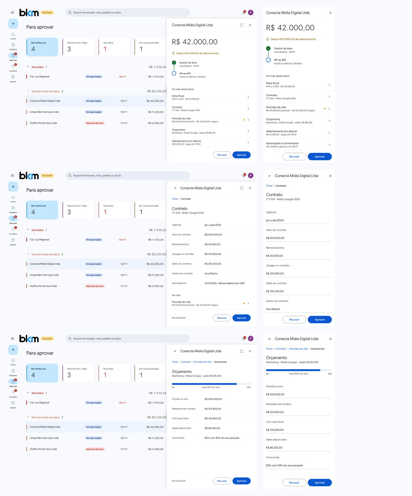

Na gaveta do pedido, o bloco **Por trás deste título** lista:

| Item | O que mostra |
| --- | --- |
| **Nota fiscal** | Número e valor da nota |
| **Contrato** | Vigência, valor, mensal previsto, já pago, saldo, gestor e quem aprovou |
| **Previsão do mês** | Previsto × o que chegou; um ponto amarelo avisa a diferença |
| **Orçamento** | Orçado no ano, realizado, com este título, saldo depois dele e quanto do ano já passou |
| **Adiantamento em aberto** | Valor e data; o aviso "Deduz R$ … de adiantamento" aparece no alto |
| **Aprovações e comentários** | Quem já aprovou, quando, e as justificativas |
| **Conversa** | As mensagens sobre o título (ver abaixo) |
| **Fornecedor** | O histórico do fornecedor |

Cada item abre um nível abaixo, e de lá se desce mais (por exemplo, Título › Contrato › Previsão do mês › Orçamento › o núcleo e o centro de custo no ano). A trilha no alto e a seta **←** voltam; o ícone de tela cheia amplia a gaveta.

**O que não dá:** ver o detalhe do que você não tem acesso. Outros núcleos e centros de custo, outras empresas e a folha PJ aparecem só somados ou com a marca "sem acesso". Medições, compras e estoque aparecem em cinza até os módulos existirem.

#### Conversar sobre o título

O título tem uma **Conversa**: uma linha do tempo com o lançamento, as aprovações, as perguntas e as respostas, que podem ter anexo.

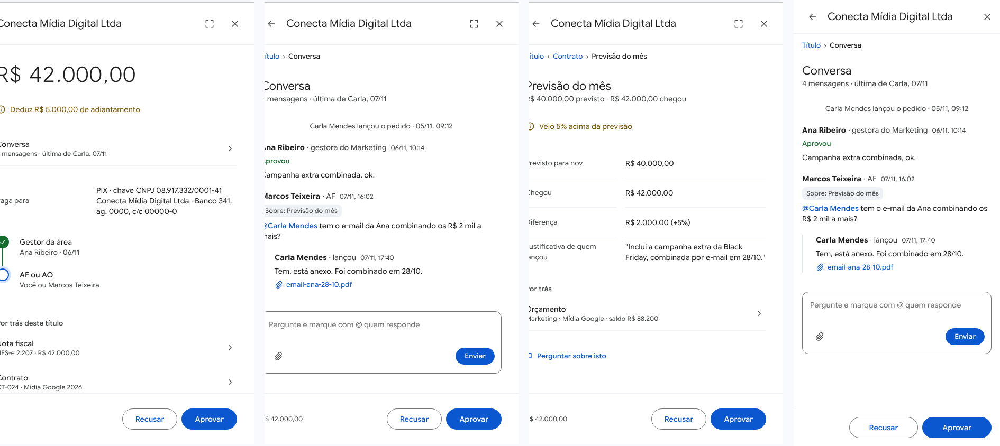

1. Na gaveta, abra **Conversa**, ou, em qualquer nível (por exemplo, na Previsão do mês), clique em **Perguntar sobre isto**. A pergunta fica marcada com o assunto ("Sobre: Previsão do mês").
2. Escreva a pergunta e marque com **@** quem deve responder.
3. Se precisar, anexe um arquivo pelo clipe.
4. Clique em **Enviar**. A resposta aparece embaixo da pergunta.

🟡 Propostas do desenho, ainda sem confirmação do Moises: perguntar não tira o pedido da sua vez nem para o relógio do SLA; as mensagens não se apagam e a edição fica registrada; a recusa entra na conversa.

🔜 **Futuro:** medições, pedidos de compra e estoque entram nessa navegação quando chegarem os módulos de obra e suprimentos. Depois, um agente poderá trazer um relatório e uma recomendação para cada título.

**O que o sistema confere:** quem lançou não aprova o próprio pedido; o pedido com multa ou juros pede também a aprovação específica.

**O que não dá:** aprovar vários pedidos de uma vez. A tela não tem aprovação em lote; cada pedido é aberto e aprovado.

### Tarefa: resolver a conferência com o Sienge

> 🧪 Telas em protótipo (linha F), ainda sem código.

**Para que serve:** tratar o que o sistema achou de diferente entre o ERP BKM e o Sienge.

**Passo a passo:**

1. No menu, abra **Conferir**. No alto aparece a hora da última leitura do Sienge.
2. Veja os três grupos: **Mudou no Sienge** (o título foi alterado lá depois de criado), **Não chegou ao Sienge** e **Fora do fluxo** (título criado direto no Sienge).
3. Clique em **Resolver** em cada linha. ⏳ O que cada Resolver faz ainda será desenhado.

## O que se pode fazer

| Você pode | Situação |
| --- | --- |
| Lançar um título com muitas parcelas, inclusive de longo prazo (ex.: terreno em 36 vezes) | ✅ |
| Parcelas de valores diferentes, como estão no documento (ex.: dois boletos de R$ 100 e R$ 200) | ✅ Na tela Lançar título, digite o valor de cada parcela (todas ou nenhuma; a soma tem de dar o valor da nota). Sem valor, as parcelas saem iguais, com o centavo que sobra na primeira. Quando o leitor acha o valor de cada parcela ou boleto, já preenche (Moises, 20/nov/2026) |
| Subir o PDF de uma fatura com senha | ✅ O sistema tenta abrir com os primeiros e com os últimos dígitos do CNPJ das empresas (de 3 dígitos até o CNPJ inteiro). Se nenhum abrir, a tela pede a senha: digite e clique em **Abrir**. A senha não fica guardada. Se não souber, preencha à mão (Moises, 20/nov/2026) |
| Chave de acesso lida pela IA com um dígito errado | ✅ O sistema confere o dígito verificador da chave da NF-e. Se não fechar, a chave fica em branco e aparece o aviso para conferir no documento (20/nov/2026) |
| Fatura com o CNPJ de quem paga mascarado (ex.: 28.***.***/****-92) | ✅ A tela mostra as empresas que fecham com os dígitos à vista e o botão **Usar …**. Confira e clique; o sistema não escolhe sozinho (20/nov/2026) |
| Começar a preencher enquanto o arquivo é lido | ✅ (25/nov/2026) A tela não espera a leitura: enquanto aparece "Lendo o arquivo…", você já pode digitar. O que você mexer nesse tempo a leitura não troca. Nota que já chegou pela busca automática de notas é lida em cerca de 1 segundo; os demais arquivos levam uns 10 segundos. |
| Guardar o PIX copia e cola de cada parcela (o QR do boleto ou da fatura) | ✅ Cada parcela tem o campo **PIX copia e cola**, opcional. Quando o boleto traz o QR, o leitor já preenche. O sistema recusa código com erro de digitação ou com valor diferente do da parcela. A tela mostra quem recebe pelo código. Se o código é de outra chave (diferente da chave PIX da parcela ou, no boleto, do CNPJ do fornecedor) ou é dinâmico, o sistema confere quem recebe e quanto o código cobra: se for o fornecedor e o valor da parcela, entra direto; se não for, ou se não der para conferir, só entra com a justificativa, que quem aprova vê na gaveta do título, e a AF recebe o alerta quando o título vai ao Sienge. O código fica no nosso sistema e não vai ao Sienge (20/nov/2026) |
| Lançar guia de imposto (IPTU, ITBI, DARF, DARM, DARE) | ✅ Na tela Lançar título, o tipo tem IPTU, ITBI, DARF, DARM (guia municipal) e DARE (guia estadual), que vão ao Sienge com o documento de mesmo nome. O leitor já reconhece o tipo. Quando a guia não mostra o CNPJ do órgão, o sistema completa pelo código que vem na linha digitável (Prefeituras de São Paulo e de São José dos Campos, Receita Federal, Sabesp, EDP, Eletropaulo, Telefônica), com um aviso para conferir. Se a guia mostra um CNPJ e o código da linha é de outro órgão, aparece um aviso para conferir a guia antes de pagar (20/nov/2026) |
| Conferir o beneficiário do boleto | ✅ Ao digitar ou ler a linha digitável, o sistema confere quem é o beneficiário registrado no banco e o valor. Se for o fornecedor e o valor da parcela, entra direto; se não for, ou se não der para conferir, o boleto só entra com a justificativa, que quem aprova vê, e a AF recebe o alerta quando o título vai ao Sienge (20/nov/2026) |
| Selo "Recebedor não confere" | ✅ Todo título em que quem recebe não é o fornecedor conferido (chave PIX de outra pessoa, PIX copia e cola ou boleto que entraram com justificativa) mostra o selo vermelho na lista de títulos, em Para aprovar e na gaveta do título, com o motivo, até ser pago, mesmo depois de aprovado (20/nov/2026) |
| Nome de quem recebe conferido | ✅ Quando o boleto ou o PIX copia e cola é conferido, o sistema compara o nome de quem recebe com a razão social do fornecedor no cadastro (o nome fantasia não vale), além do CPF/CNPJ. Se o nome não bate, a parcela só entra com a justificativa, e o título fica com o selo "Recebedor não confere" até o pagamento (20/nov/2026) |
| Selo "Credor novo" | ✅ Título de fornecedor que nunca teve outro título enviado ao Sienge ou pago mostra o selo amarelo "Credor novo" na lista de títulos, em Para aprovar e na gaveta, com o dia do cadastro. É o momento de conferir se o CPF/CNPJ é mesmo do fornecedor. Os fornecedores trazidos do Sienge também aparecem como novos até o primeiro título deles sair pelo sistema (20/nov/2026) |
| Trocar o fornecedor depois de conferir | ✅ Com um boleto ou PIX copia e cola já conferido em nome do fornecedor, o título não aceita a troca do fornecedor: tire a forma de pagamento (ou confira de novo com o fornecedor novo) antes de trocar. Antes de ir ao Sienge, o sistema confere de novo se quem recebe continua sendo o fornecedor do título (20/nov/2026) |
| Pagar uma parcela inteira com uma operação (o caso comum) | ✅ |
| Pagar só parte de uma parcela e o resto depois | ✅ (Moises, 7/nov/2026) |
| Adiantar dinheiro a um fornecedor, ligado ou não a um título, e abater aos poucos em várias parcelas e títulos | ✅ (Moises, 7/nov/2026) |
| Registrar juros, multa e desconto na hora do pagamento | ✅ (Moises, 7/nov/2026) |
| Lançar a nota com impostos retidos e caução | ✅ (Moises, 7/nov/2026) |
| Mandar vários pagamentos juntos num lote ao banco | ✅ O lote é só um agrupamento de envio; cada operação continua pagando uma parcela |

## O que não se pode fazer

| Não dá | Por quê |
| --- | --- |
| Lançar a mesma nota duas vezes (mesmo emitente, tipo, número e série) | Trava do ERP BKM. O Sienge da BKM aceita número repetido, então a trava é nossa (teste de 6/nov/2026) |
| Juntar notas, faturas ou boletos diferentes num título só | Um título por documento, por motivo (Moises, 18/nov/2026). Cada nota gera o próprio título; o boleto precisa ter o valor da parcela. A mesma nota continua podendo ser dividida entre centros e divisões |
| Pôr uma natureza de PJ junto com outra natureza no mesmo título, nota ou contrato | O pagamento de PJ sobe sozinho (Moises, 18/nov/2026) |
| Editar uma nota ou um título depois de confirmado | O título só muda de situação pelas baixas. Corrigir é cancelar e lançar de novo |
| Baixar mais do que o saldo da parcela ou do que o saldo do pagamento | Trava do banco de dados |
| Usar o adiantamento de um fornecedor para baixar título de outro, ou de outra empresa | A baixa só vale para a mesma empresa e a mesma pessoa |
| Abater o adiantamento num título de outro centro de custo sem a aprovação de AF, AO ou AD | O adiantamento é carimbado com núcleo e centro de custo (Moises, 14/nov/2026) |
| Lançar juros ou multa na nota | Eles só se sabem na hora de pagar, por isso ficam na baixa |
| Autorizar o pagamento ou dar ciência no Sienge pelo ERP BKM | A API do Sienge não tem esses comandos. Continuam à mão no Sienge |
| Corrigir empresa, fornecedor, emissão ou número de parcelas de um título já enviado ao Sienge | A API não altera esses campos. Precisa apagar no Sienge e lançar de novo |

## Como juros, multa, desconto e adiantamento aparecem nos números

✅ Todo pagamento entra primeiro como **adiantamento ao fornecedor**. Cada baixa tira o valor de lá e o põe na natureza do título. Na prática:

- No pagamento comum, isso acontece no mesmo dia e você nem percebe.
- No adiantamento, o valor fica parado em "Adiantamentos" até ser abatido.
- Juros e multa vão para uma natureza própria de juros e multas pagos; o desconto obtido, para a de descontos.
- ✅ Pagar com juros ou multa exige uma aprovação a mais, de uma pessoa definida pelo administrador (padrão: a AD). Ver [Aprovações](../transversais/aprovacoes.md#pagamento-com-multa-ou-juros).

Assim, o realizado do sistema sempre bate com o dinheiro que saiu do banco.

---

## Tarefa: cadastrar uma assinatura recorrente (telefone, internet, aluguel...)

> ⚠️ Roteiro antigo, de antes das telas. Na primeira etapa, use [cadastrar uma conta recorrente](#tarefa-cadastrar-uma-conta-recorrente). Este fica para quando o ERP gerar as previsões do fluxo de caixa.

**Para que serve:** ter as contas fixas no fluxo de caixa sem criar contrato fictício.

**Passo a passo:**

1. Abra **Contas a pagar › Compromissos** e clique em **Novo compromisso**.
2. Escolha o tipo **Assinatura recorrente**.
3. Escolha o fornecedor (ver [Pessoas](../cadastros/pessoas.md)) e a empresa que paga.
4. Informe a periodicidade (mensal, por exemplo), o dia de vencimento e o valor estimado por período.
5. Em **Classificação**, escolha o núcleo econômico, o centro de custo e a natureza (por exemplo, Corporativo, Administrativo e Gerais › Administrativo › Internet). Se for dividido, use **Ratear**.
6. Informe até quando gerar as previsões.
7. Salve. O sistema cria uma previsão para cada vencimento, sem duplicar.

**E depois?** Todo mês, quando a conta chega, você a lança como nota (ver [Lançar nota fiscal](lancar-nota-fiscal.md)) e ela consome a previsão do mês.

## Tarefa: pagar uma parcela

> ⏳ Ainda a definir se o pagamento será registrado no ERP BKM ou só lido do Sienge e do banco (módulo de Bancos). O roteiro abaixo vale para o registro no ERP BKM.

1. Abra **Contas a pagar › Parcelas a pagar** e filtre pelo vencimento.
2. Abra a parcela e clique em **Pagar**.
3. Escolha a conta bancária e a data do pagamento.
4. Se pagou atrasado, informe juros e multa; se teve desconto, informe o desconto.
5. Confirme. A parcela fica baixada (paga).

## Adiantamento sem nota: prazo e travas

- ✅ **Todo pagamento e todo adiantamento** (a fornecedor, a funcionário ou a qualquer outro) **sai do banco com núcleo econômico e centro de custo**. Sem os dois, o pagamento não sai. Só a transferência entre contas da própria empresa dispensa (Moises, 14/nov/2026).

- ✅ Há um **prazo para a nota chegar**, de **30 dias** por padrão, que o master ou um administrador pode mudar (Moises, 7/nov/2026).
- ✅ Quando o prazo vence, o sistema avisa o financeiro e o gestor do contrato (Moises, 7/nov/2026).
- ✅ Enquanto houver um adiantamento sem nota, o fornecedor **só recebe outro adiantamento com a aprovação da AD** (Moises, 7/nov/2026; antes era "nenhum").
- ~~Nenhum título desse fornecedor é pago sem deduzir o adiantamento em aberto, mesmo que seja de outro centro, salvo com a AD (7/nov/2026)~~. Substituído em 14/nov/2026:
- ✅ **O adiantamento é carimbado** com o núcleo econômico e o centro de custo, e **só se abate em título do mesmo centro de custo**. Abater num título de outro centro só com a aprovação de alguém da **AF, da AO ou da AD**. Essa regra é **configurável** pelo administrador, e toda mudança fica registrada (Moises, 14/nov/2026).
- ✅ O título de um fornecedor que tem adiantamento aberto em outro centro **fica pendente** até alguém da AF, da AO ou da AD aprovar o abatimento cruzado, com justificativa, ou até a AD liberar o pagamento sem deduzir (Moises, 14/nov/2026).
- ✅ **O que o administrador configura**, com registro de cada mudança: se a trava vale; quais camadas aprovam o abatimento em outro centro (padrão AF, AO ou AD); quem libera pagar sem deduzir (padrão AD); e quem está em cada camada (Moises, 14/nov/2026).
- Quem lançou o pagamento não aprova o abatimento dele, e quem lançou o título não libera o pagamento dele sem abater o adiantamento (regra geral: quem lança não aprova).
- 🟡 Regra do código, a confirmar com o Moises: a liberação para pagar sem deduzir vale só para os adiantamentos que já existiam quando ela foi aprovada. Se sair um adiantamento novo para o fornecedor, o título precisa de nova liberação.
- Quem criou o título ou o pagamento, e quando, o sistema grava sozinho; ninguém altera.
- ✅ Pagamento e adiantamento também saem carimbados com a **divisão**, quando o centro tem divisões; o adiantamento só abate títulos da mesma divisão, e abater em outra divisão do mesmo centro pede a aprovação do **gestor do centro** ou de AF, AO ou AD; em outro centro, só AF, AO ou AD (Moises, 15/nov/2026). Atenção na implantação: adiantamento lançado antes de o centro ganhar divisões fica sem divisão e, depois, só abate com essa aprovação.
- ✅ O adiantamento só abate sem aprovação o título que está **inteiro** no mesmo núcleo, centro e divisão do adiantamento. Se uma linha do rateio está fora, mesmo 1%, o título todo pede aprovação: o gestor do centro, quando tudo está no centro dele e só a divisão muda; com uma linha em outro centro, só AF, AO ou AD (Moises, 15/nov/2026).
- ✅ O abatimento sem aprovação exige **o mesmo núcleo econômico e o mesmo centro de custo**; e, entre os adiantamentos que servem, **abate-se primeiro o mais antigo** (Moises, 14/nov/2026).
- ✅ **Todo adiantamento começa por um pedido de adiantamento**, com fornecedor, valor, competência, um núcleo econômico e um centro de custo. O pedido passa pela mesma alçada de pagamento (gestor da área, AF e, acima de R$ 50 mil no mês, AD) (Moises, 14/nov/2026).
- ✅ O dinheiro só sai **depois do pedido aprovado**, para o mesmo fornecedor, com o mesmo núcleo e centro, e sem passar do valor do pedido. Pedido recusado não paga. Pago por inteiro, o pedido se encerra.
- ✅ O adiantamento **conta uma vez** no acumulado do mês. Quando chega a nota do mesmo fornecedor, no mesmo núcleo e centro, ela soma só o que passa do adiantamento já pago. Exemplo: adiantamento de R$ 20 mil e depois nota de R$ 25 mil somam R$ 25 mil, não R$ 45 mil.
- A parte do adiantamento que já foi abatida num título não desconta de novo. Exemplo: um adiantamento de R$ 3 mil, com R$ 2 mil abatidos numa nota antiga, só desconta mais R$ 1 mil de uma nota nova.
- 🟡 Regras do código, a confirmar com o Moises: o pedido entra no acumulado ao ser confirmado, como os outros títulos, e não só depois de aprovado; e um pedido aprovado mas ainda não pago não desconta da nota.
- O adiantamento sem nota passa pela mesma aprovação do título, mais o gestor do contrato (ver [Aprovações](../transversais/aprovacoes.md#os-cinco-momentos-de-aprovação)).

## Tarefa: pedir um adiantamento sem nota

> 🧪 Telas em protótipo (linha F), ainda sem código.

1. Abra **Pedidos**, clique em **Novo pedido** e escolha **Adiantamento sem nota**.
2. Preencha o fornecedor, o valor e o **motivo** ("Por que pagar antes da nota?"), que é obrigatório.
3. O **prazo da nota** vem preenchido com 30 dias. A tela avisa: depois disso, o fornecedor fica bloqueado.
4. Pagamento, núcleo econômico, centro de custo e natureza vêm do cadastro do fornecedor (o PIX já conferido pelo financeiro).
5. Clique em **Enviar** (ou **Salvar rascunho**).

## Tarefa: registrar um adiantamento e abater aos poucos

1. Abra **Contas a pagar › Pagamentos** e clique em **Novo pagamento**.
2. Escolha o fornecedor, a empresa, a conta, a data e o valor. Se for ligado a um contrato, escolha o contrato.
3. Salve sem baixar nada. O valor aparece como saldo de adiantamento do fornecedor.
4. Quando a nota seguinte chegar e o título for lançado, abra a parcela e clique em **Abater adiantamento**.
5. Informe quanto do adiantamento baixa esta parcela (por exemplo, 10% de cada medição).
6. Confirme. O saldo do adiantamento diminui; o resto continua disponível para as próximas.

**O que o sistema confere:** mesmo fornecedor e mesma empresa; a baixa não passa do saldo do adiantamento nem do saldo da parcela.

## ⏳ Em aberto

- O que fazer com um pagamento atrasado de uma competência que já foi fechada: travar, ou lançar no primeiro mês aberto.
- Quem aprova o pagamento e com que alçadas (sessão de [aprovações](../transversais/aprovacoes.md)).
- Estorno de pagamento, remessa e conciliação (módulo de Bancos).
