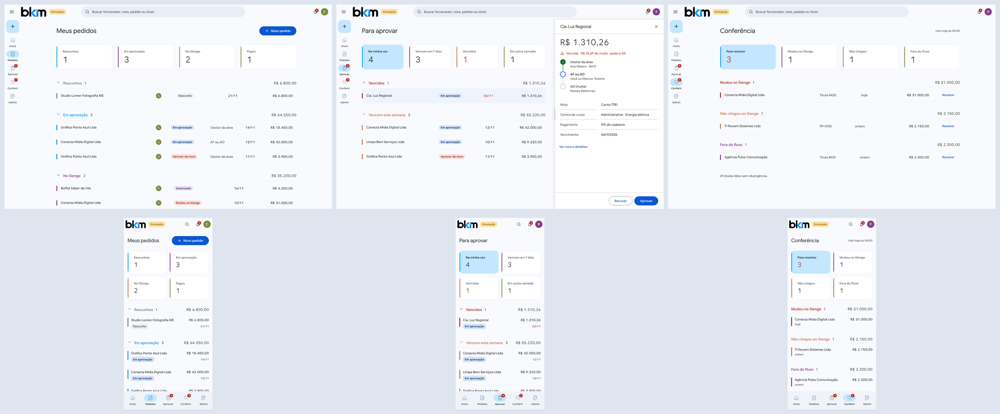
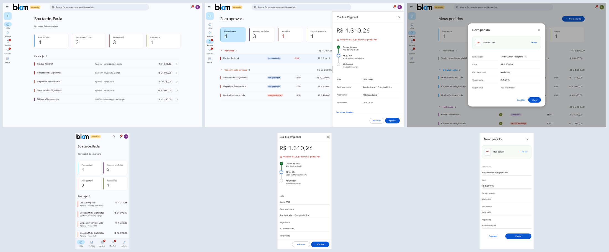
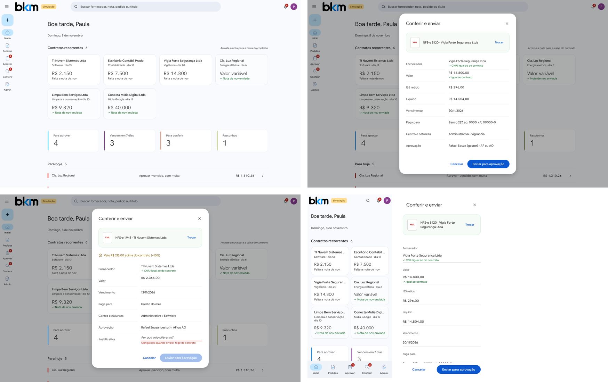
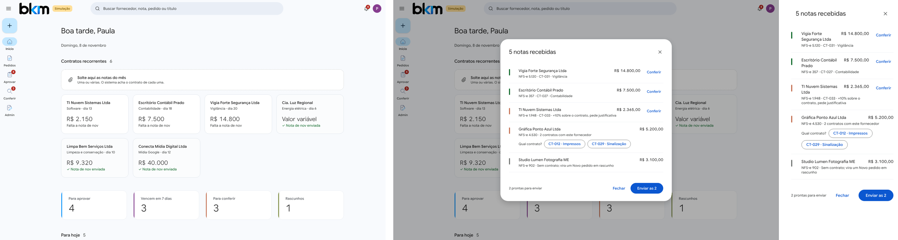
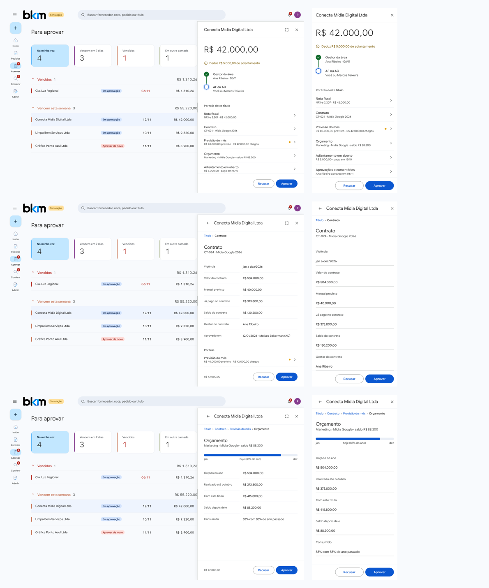
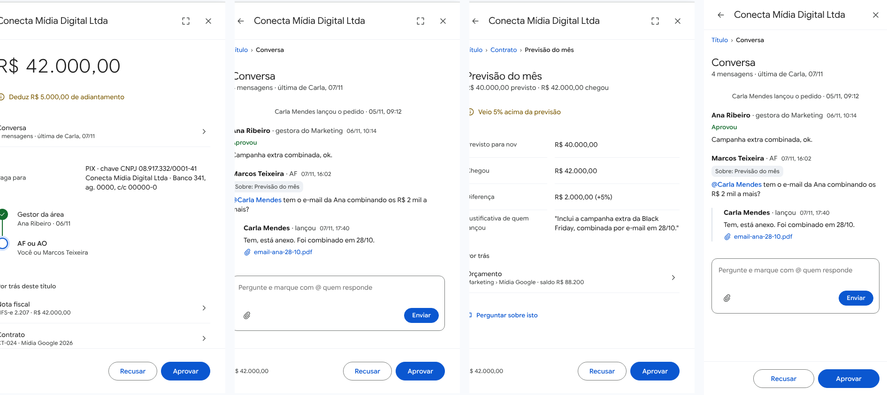

# Contas a pagar: do compromisso ao pagamento

[← Sumário](../README.md)

## O caminho de um gasto

✅ **Decidido** (7/nov/2026). Todo gasto passa por até cinco etapas, e cada uma tem o seu lugar no sistema. **A dívida só existe a partir do título.** Antes disso, o que há é expectativa.

```
Compromisso  →  Previsão  →  Documento  →  Título (parcelas)  →  Pagamento e quitação
(o acordo)      (o esperado)  (a nota)      (a dívida)            (o dinheiro que saiu)
```

| Etapa | O que é | Exemplo |
| --- | --- | --- |
| **Compromisso** | O acordo que vai gerar gasto | Contrato com a empreiteira; assinatura da internet; pedido de compra |
| **Previsão** | O gasto esperado, que ainda não é dívida | "Internet de março, cerca de R$ 400" |
| **Documento** | A nota, o boleto ou a guia que chegou | NFS-e 112 da empreiteira |
| **Título** | A dívida real, com uma ou mais parcelas | Título de R$ 9.000 em 3 parcelas |
| **Pagamento** | O dinheiro que saiu do banco | Pix de R$ 3.000 em 10/03 |

### Tipos de compromisso

✅ As origens de gasto são poucas: **contrato**, **pedido de compra**, **assinatura recorrente**, **despesa avulsa**, **guia de imposto** e **folha**. O que é variado (marketing, limpeza de terreno, vigilância, material de escritório...) é a **natureza** do gasto, que é classificação, não um tipo novo de cadastro. Ver [Classificação](classificacao.md).

✅ A **assinatura recorrente** substitui o contrato fictício de hoje: ela tem periodicidade e valor estimado por período, e gera sozinha uma previsão para cada vencimento.

### Previsão não é título

✅ **Decidido** (6 e 7/nov/2026): as previsões ficam **só no ERP BKM** e não são lançadas no Sienge. Motivo, comprovado em teste no Sienge em 6/nov/2026: um título criado pela API não pode ter tipo, número nem valor alterados depois, então uma previsão no Sienge nunca vira título real e teria de ser apagada à mão todo mês.

Quando a nota chega e o título nasce, ele **consome** a previsão correspondente, e a diferença entre o previsto e o realizado fica registrada. Uma previsão não se edita: se mudou, cancela-se e cria-se outra.

## Primeira etapa da implantação: o pedido de pagamento

✅ **Decidido** (Moises, 8/nov/2026):

- **A obra fica fora** desta etapa. Os demais departamentos usam o ERP BKM do compromisso até a chegada da nota.
- Quando a nota chega, quem a recebe cria no ERP BKM o **pedido de pagamento**, subindo a nota e o título. O ERP BKM guarda tudo.
- O ERP BKM **cria o título no Sienge** pela API, e o pagamento segue no Sienge até o fim.
- Depois, o ERP BKM **lê no Sienge o que aconteceu** com o título e guarda.
- **Conferência:** uma rotina do sistema confere se todos os títulos do ERP BKM chegaram mesmo ao Sienge. No começo, uma pessoa também confere à mão.
- **Relatório para cada pessoa:** cada um recebe a lista dos títulos que cadastrou e que foram ao Sienge, para conferir se foi tudo.

> ⚠️ **Passo manual no Sienge:** a autorização, o pagamento e o lote (remessa pelo Nexxera) continuam feitos no Sienge. Ver [O que ainda é feito à mão no Sienge](../transversais/passos-manuais-no-sienge.md).

✅ Também confirmado (Moises, 8/nov/2026):

- **O título vai ao Sienge pela API, nunca redigitado**, já com a nota anexada, os impostos e o PIX ou o boleto. O ERP BKM guarda o número de cada título no Sienge.
- **Pré-requisito:** enquanto os títulos passarem pelo Sienge, o pedido de pagamento só se conclui no ERP BKM com **todas as informações de pagamento** (PIX, conta ou boleto) preenchidas e aprovadas. Só então o título é criado no Sienge, já completo.
- **A conferência vai nos dois sentidos:** aponta o título do ERP BKM que não chegou ao Sienge, o título criado direto no Sienge fora do fluxo e o título mudado no Sienge depois de criado (valor, conta, PIX).
- O relatório para cada pessoa fica, mas pode sair quando a conferência à mão confirmar que o sistema não erra.

Teste de 8/nov/2026 (título 8422): o título criado pela API aceitou o PIX depois de criado, e a API aceita os impostos já na criação.

⏳ Em discussão: tirar no Sienge a permissão de criar e alterar títulos e dados bancários dos departamentos que entrarem no ERP BKM, para fechar a brecha de pagar fora do fluxo. O custo é que um lançamento urgente passa a depender do ERP BKM.

### As telas do pedido de pagamento

> 🧪 **Protótipo escolhido, ainda sem código** (Moises, 8/nov/2026: "linha F"). Os nomes abaixo são os do protótipo e podem mudar até a tela existir. Regra do Moises para todas as telas: bastante área branca, muito respiro.





O menu tem cinco itens: **Início**, **Pedidos**, **Aprovar**, **Conferir** e **Admin**. No celular, eles ficam numa barra embaixo.

| Tela | O que mostra |
| --- | --- |
| **Início** | No alto, os **Contratos recorrentes**: a caixa única **Solte aqui as notas do mês** (várias notas de uma vez) e, abaixo, uma caixa por contrato, para soltar a nota de um só; depois quatro contadores (Para aprovar, Vencem em 7 dias, Para conferir, Rascunhos) e a lista **Para hoje**, com o que você precisa fazer hoje |
| **Meus pedidos** | Contadores Rascunhos, Em aprovação, No Sienge e Pagos, e os pedidos agrupados por situação, com a soma de cada grupo |
| **Novo pedido** | Uma janela curta. Você sobe o XML da nota e ela preenche fornecedor, valor, centro de custo e vencimento |
| **Para aprovar** | Contadores Na minha vez, Vencem em 7 dias, Vencidos e Em outra camada; os pedidos agrupados por prazo |
| **Conferência** | O que o sistema achou ao comparar com o Sienge: **Mudou no Sienge**, **Não chegou** e **Fora do fluxo**, cada um com **Resolver** |

### Contas recorrentes: os dois tipos

> ✅ Decidido pelo Moises, 8/nov/2026: as contas recorrentes entram já na primeira etapa da implantação. Contratos de obra ficam para o módulo de Suprimentos.

Conta recorrente é a que se repete todo mês. Ela fica cadastrada uma vez e ganha uma caixa no **Início**. Há dois tipos:

| Tipo | Exemplos | O que o cadastro guarda |
| --- | --- | --- |
| **Contrato de serviço** | software, contabilidade, vigilância, limpeza, mídia | fornecedor, empresa pagadora, valor mensal, vigência, reajuste, dia de vencimento, dados de pagamento (PIX, conta ou boleto), centro de custo, natureza, gestor e o PDF do contrato |
| **Conta de consumo** | energia, água, telefone | faixa máxima por mês, teto no ano e o número da instalação ou do cliente (é ele que identifica a fatura quando a concessionária usa um CNPJ só para todas as contas) |

**Aprovação do cadastro:** cada conta recorrente é aprovada pelo gestor e por alguém da AF ou da AO antes de valer. **Trocar PIX, conta, valor ou faixa exige nova aprovação.**

### Tarefa: enviar a nota de um contrato recorrente

> 🧪 Telas em protótipo (linha F), ainda sem código. Pedido do Moises, 8/nov/2026.

**Para que serve:** mandar a nota mensal de um contrato fixo (software, contabilidade, vigilância, energia...) quase sem digitar, porque o contrato já tem os dados. São os compromissos do tipo [assinatura recorrente](#tipos-de-compromisso).

**Quem faz:** quem recebe a nota do contrato.



**Passo a passo:**

1. Abra o **Início**. No alto, a seção **Contratos recorrentes** mostra uma caixa por contrato: fornecedor, natureza, dia, valor mensal (ou "Valor variável") e a situação da nota do mês ("Falta a nota de nov" ou "Nota de nov enviada").
2. **Arraste o arquivo XML da nota para a caixa do contrato.** No celular, ou se preferir, toque na caixa e solte a nota no campo que aparece.
3. Abre a janela **Conferir e enviar**, já preenchida pela nota e pelo contrato: fornecedor, valor, retenções (por exemplo, ISS), líquido, vencimento, para onde paga (PIX, conta ou boleto), centro e natureza, e as camadas de aprovação.
4. Confira. Se o valor veio diferente do contrato, aparece o aviso (por exemplo, "Veio R$ 215,00 acima do contrato (+10%)") e é preciso escrever a **justificativa**.
5. Clique em **Enviar para aprovação**.

**O que o sistema confere** (regra do Moises, 8/nov/2026, no documento dos diretores), antes de montar o pedido:

- o CNPJ de quem emitiu a nota é o do fornecedor da conta;
- quem recebe a nota (o tomador) é a empresa pagadora certa;
- o contrato está vigente;
- o mês ainda não tem nota (não deixa mandar a nota duas vezes);
- o valor cabe na regra: no contrato de serviço, o valor mensal com os reajustes aprovados; na conta de consumo, a faixa do mês e o teto do ano.

O que não bate vira **exceção**: o pedido só segue com justificativa. Na tela, as marcas "CNPJ igual ao do contrato" e "igual ao contrato" aparecem embaixo do fornecedor e do valor.

**Quem não pode aprovar esse pedido:** quem arrastou a nota e quem mexeu por último no cadastro da conta.

### Tarefa: enviar várias notas do mês de uma vez

> 🧪 Telas em protótipo (linha F), ainda sem código. Pedido do Moises, 8/nov/2026.

**Para que serve:** no começo do mês, mandar todas as notas dos contratos recorrentes de uma só vez, sem procurar a caixa de cada contrato.

**Quem faz:** quem recebe as notas dos contratos.



**Passo a passo:**

1. Abra o **Início**. Em **Contratos recorrentes**, acima das caixas dos contratos, fica a caixa **Solte aqui as notas do mês**.
2. **Arraste todos os arquivos XML das notas para essa caixa**, de uma vez. No celular, toque na caixa e escolha os arquivos.
3. O sistema acha o contrato de cada nota pelo CNPJ de quem emitiu e de quem recebe a nota (a BKM). Se o mesmo fornecedor tem mais de um contrato, ele tenta desempatar pelo serviço, pelo texto da nota e pelo valor.
4. Abre a janela **N notas recebidas**, com uma linha por nota, em quatro situações:
   - **Pronta** (faixa verde): bate com o contrato. Pode ir direto.
   - **Com divergência** (faixa laranja), por exemplo "+10% sobre o contrato": clique em **Conferir** e escreva a justificativa.
   - **Dúvida entre contratos** (faixa laranja): o sistema mostra "Qual contrato?" com os contratos possíveis. Clique no certo.
   - **Sem contrato** (faixa cinza): a nota não é de nenhum contrato recorrente e vira um **Novo pedido em rascunho**, para você completar em [criar um pedido de pagamento](#tarefa-criar-um-pedido-de-pagamento).
5. Clique em **Enviar as N**. Vão para aprovação **só as prontas**; as outras ficam na janela até você resolver (as sem contrato ficam em Rascunhos).

**O que você não pode fazer:** enviar uma nota com divergência sem justificativa, nem uma nota com dúvida entre contratos sem escolher o contrato.

> ⏳ Depende de teste: a nota também pode casar com um **pedido de compra aprovado** (por exemplo, "Pedido de compra 4.512 · saldo R$ 6.400,00, fica R$ 2.560,00"). Nota parcial abate do saldo e o pedido continua aberto. Isso só vale na primeira etapa se a consulta de pedidos de compra do Sienge (GET /purchase-orders) funcionar no teste; senão, entra só com o módulo de Compras.

> 🟡 Proposta ainda não decidida pelo Moises: receber notas pelo **WhatsApp**. O WhatsApp só recebe a nota; o sistema responde com um resumo e um link, e o envio é feito no aplicativo, com login. Só números cadastrados seriam aceitos, e PDF sem XML ganharia o selo "conferência manual".

### Tarefa: criar um pedido de pagamento

> 🧪 Telas em protótipo (linha F), ainda sem código.

**Para que serve:** levar uma nota que chegou até o pagamento no Sienge, passando pelas aprovações.

**Quem faz:** quem recebeu a nota, em qualquer departamento fora a obra.

**Passo a passo:**

1. No menu, abra **Pedidos** (ou use o **+** no alto do menu) e clique em **Novo pedido**.
2. Suba o arquivo XML da nota. O sistema preenche fornecedor, valor, centro de custo e vencimento.
3. Confira cada campo e complete o que faltar, principalmente o **pagamento** (PIX, conta ou boleto). **Sem os dados de pagamento completos, o pedido não se conclui.**
4. Clique em **Enviar**. O pedido aparece em **Meus pedidos**, no grupo Em aprovação.

Sem os dados de pagamento, o **Enviar** fica travado: o campo Pagamento fica em vermelho com o aviso "Informe PIX, conta ou boleto para enviar". Nesse caso, clique em **Salvar rascunho** e volte quando tiver os dados. Motivo: a aprovação cobre também a conta e o PIX, então não dá para aprovar primeiro e informar o pagamento depois.

**O que o sistema confere:** nota repetida (mesmo emitente, tipo, número e série) é recusada; o título só vai ao Sienge completo.

**E depois?** O pedido passa de Em aprovação para No Sienge e depois para Pagos. Você recebe a lista do que foi ao Sienge para conferir.

**Se der errado:** um pedido recusado ou mudado volta com a marca **Aprovar de novo**. Se o título não chegar ao Sienge, ele aparece na **Conferência**.

### Tarefa: aprovar um pedido de pagamento

> 🧪 Telas em protótipo (linha F), ainda sem código.

**Para que serve:** dar a sua aprovação na camada em que você está.

**Quem faz:** quem está na lista de aprovadores da regra (ver [Aprovações](../transversais/aprovacoes.md)).

**Passo a passo:**

1. No menu, abra **Aprovar**. Comece pelos grupos **Vencidos** e **Vencem esta semana**.
2. Clique no pedido. Ele abre numa gaveta à direita, com o valor, os avisos (por exemplo, "Vencido, R$ 25,69 de multa, pede a AD"), as camadas de aprovação (quem já aprovou, de quem é a vez e quem vem depois), a nota, o centro de custo, o pagamento e o vencimento.
3. Para decidir, desça pelo que está **por trás deste título**, só com cliques (ver abaixo).
4. Clique em **Aprovar** ou em **Recusar**. Os dois botões ficam embaixo da gaveta em qualquer nível.

#### Ver o que está por trás do título

✅ **Pedido do Moises** (8/nov/2026): o aprovador navega da linha de aprovação até a origem do gasto, **só com cliques**, para ter tudo o que precisa para decidir.



Na gaveta do pedido, o bloco **Por trás deste título** lista:

| Item | O que mostra |
| --- | --- |
| **Nota fiscal** | Número e valor da nota |
| **Contrato** | Vigência, valor, mensal previsto, já pago, saldo, gestor e quem aprovou |
| **Previsão do mês** | Previsto × o que chegou; um ponto amarelo avisa a diferença |
| **Orçamento** | Orçado no ano, realizado, com este título, saldo depois dele e quanto do ano já passou |
| **Adiantamento em aberto** | Valor e data; o aviso "Deduz R$ … de adiantamento" aparece no alto |
| **Aprovações e comentários** | Quem já aprovou, quando, e as justificativas |
| **Conversa** | As mensagens sobre o título (ver abaixo) |
| **Fornecedor** | O histórico do fornecedor |

Cada item abre um nível abaixo, e de lá se desce mais (por exemplo, Título › Contrato › Previsão do mês › Orçamento › o centro de custo no ano). A trilha no alto e a seta **←** voltam; o ícone de tela cheia amplia a gaveta.

**O que não dá:** ver o detalhe do que você não tem acesso. Outros centros de custo, outras empresas e a folha PJ aparecem só somados ou com a marca "sem acesso". Medições, compras e estoque aparecem em cinza até os módulos existirem.

#### Conversar sobre o título

O título tem uma **Conversa**: uma linha do tempo com o lançamento, as aprovações, as perguntas e as respostas, que podem ter anexo.



1. Na gaveta, abra **Conversa**, ou, em qualquer nível (por exemplo, na Previsão do mês), clique em **Perguntar sobre isto**. A pergunta fica marcada com o assunto ("Sobre: Previsão do mês").
2. Escreva a pergunta e marque com **@** quem deve responder.
3. Se precisar, anexe um arquivo pelo clipe.
4. Clique em **Enviar**. A resposta aparece embaixo da pergunta.

🟡 Propostas do desenho, ainda sem confirmação do Moises: perguntar não tira o pedido da sua vez nem para o relógio do SLA; as mensagens não se apagam e a edição fica registrada; a recusa entra na conversa.

🔜 **Futuro:** medições, pedidos de compra e estoque entram nessa navegação quando chegarem os módulos de obra e suprimentos. Depois, um agente poderá trazer um relatório e uma recomendação para cada título.

**O que o sistema confere:** quem lançou não aprova o próprio pedido; o pedido com multa ou juros pede também a aprovação específica.

**O que não dá:** aprovar vários pedidos de uma vez. A tela não tem aprovação em lote; cada pedido é aberto e aprovado.

### Tarefa: resolver a conferência com o Sienge

> 🧪 Telas em protótipo (linha F), ainda sem código.

**Para que serve:** tratar o que o sistema achou de diferente entre o ERP BKM e o Sienge.

**Passo a passo:**

1. No menu, abra **Conferir**. No alto aparece a hora da última leitura do Sienge.
2. Veja os três grupos: **Mudou no Sienge** (o título foi alterado lá depois de criado), **Não chegou ao Sienge** e **Fora do fluxo** (título criado direto no Sienge).
3. Clique em **Resolver** em cada linha. ⏳ O que cada Resolver faz ainda será desenhado.

## O que se pode fazer

| Você pode | Situação |
| --- | --- |
| Lançar um título com muitas parcelas, inclusive de longo prazo (ex.: terreno em 36 vezes) | ✅ |
| Pagar uma parcela inteira com uma operação (o caso comum) | ✅ |
| Pagar só parte de uma parcela e o resto depois | ✅ (Moises, 7/nov/2026) |
| Adiantar dinheiro a um fornecedor, ligado ou não a um título, e abater aos poucos em várias parcelas e títulos | ✅ (Moises, 7/nov/2026) |
| Registrar juros, multa e desconto na hora do pagamento | ✅ (Moises, 7/nov/2026) |
| Lançar a nota com impostos retidos e caução | ✅ (Moises, 7/nov/2026) |
| Mandar vários pagamentos juntos num lote ao banco | ✅ O lote é só um agrupamento de envio; cada operação continua pagando uma parcela |

## O que não se pode fazer

| Não dá | Por quê |
| --- | --- |
| Lançar a mesma nota duas vezes (mesmo emitente, tipo, número e série) | Trava do ERP BKM. O Sienge da BKM aceita número repetido, então a trava é nossa (teste de 6/nov/2026) |
| Editar uma nota ou um título depois de confirmado | O título só muda de situação pelas quitações. Corrigir é cancelar e lançar de novo |
| Quitar mais do que o saldo da parcela ou do que o saldo do pagamento | Trava do banco de dados |
| Usar o adiantamento de um fornecedor para quitar título de outro, ou de outra empresa | A quitação só vale para a mesma empresa e a mesma pessoa |
| Lançar juros ou multa na nota | Eles só se sabem na hora de pagar, por isso ficam na quitação |
| Autorizar o pagamento ou dar ciência no Sienge pelo ERP BKM | A API do Sienge não tem esses comandos. Continuam à mão no Sienge |
| Corrigir empresa, fornecedor, emissão ou número de parcelas de um título já enviado ao Sienge | A API não altera esses campos. Precisa apagar no Sienge e lançar de novo |

## Como juros, multa, desconto e adiantamento aparecem nos números

✅ Todo pagamento entra primeiro como **adiantamento ao fornecedor**. Cada quitação tira o valor de lá e o põe na natureza do título. Na prática:

- No pagamento comum, isso acontece no mesmo dia e você nem percebe.
- No adiantamento, o valor fica parado em "Adiantamentos" até ser abatido.
- Juros e multa vão para uma natureza própria de juros e multas pagos; o desconto obtido, para a de descontos.
- ✅ Pagar com juros ou multa exige uma aprovação a mais, de uma pessoa definida pelo administrador (padrão: a AD). Ver [Aprovações](../transversais/aprovacoes.md#pagamento-com-multa-ou-juros).

Assim, o realizado do sistema sempre bate com o dinheiro que saiu do banco.

---

## Tarefa: cadastrar uma assinatura recorrente (telefone, internet, aluguel...)

> ⏳ As telas ainda não existem.

**Para que serve:** ter as contas fixas no fluxo de caixa sem criar contrato fictício.

**Passo a passo:**

1. Abra **Contas a pagar › Compromissos** e clique em **Novo compromisso**.
2. Escolha o tipo **Assinatura recorrente**.
3. Escolha o fornecedor (ver [Pessoas](../cadastros/pessoas.md)) e a empresa que paga.
4. Informe a periodicidade (mensal, por exemplo), o dia de vencimento e o valor estimado por período.
5. Em **Classificação**, escolha o centro de custo e a natureza (por exemplo, Sede e Gerais › Administrativo › Internet). Se for dividido, use **Ratear**.
6. Informe até quando gerar as previsões.
7. Salve. O sistema cria uma previsão para cada vencimento, sem duplicar.

**E depois?** Todo mês, quando a conta chega, você a lança como nota (ver [Lançar nota fiscal](lancar-nota-fiscal.md)) e ela consome a previsão do mês.

## Tarefa: pagar uma parcela

> ⏳ Ainda a definir se o pagamento será registrado no ERP BKM ou só lido do Sienge e do banco (módulo de Bancos). O roteiro abaixo vale para o registro no ERP BKM.

1. Abra **Contas a pagar › Parcelas a pagar** e filtre pelo vencimento.
2. Abra a parcela e clique em **Pagar**.
3. Escolha a conta bancária e a data do pagamento.
4. Se pagou atrasado, informe juros e multa; se teve desconto, informe o desconto.
5. Confirme. A parcela fica quitada.

## Adiantamento sem nota: prazo e travas

- ✅ Há um **prazo para a nota chegar**, de **30 dias** por padrão, que o master ou um administrador pode mudar (Moises, 7/nov/2026).
- ✅ Quando o prazo vence, o sistema avisa o financeiro e o gestor do contrato (Moises, 7/nov/2026).
- ✅ Enquanto houver um adiantamento sem nota, o fornecedor **só recebe outro adiantamento com a aprovação da AD** (Moises, 7/nov/2026; antes era "nenhum").
- ✅ **Nenhum título desse fornecedor é pago sem deduzir o adiantamento em aberto**, mesmo que o título seja de outro centro de custo, salvo com a aprovação da AD (Moises, 7/nov/2026).
- O adiantamento sem nota passa pela mesma aprovação do título, mais o gestor do contrato (ver [Aprovações](../transversais/aprovacoes.md#os-cinco-momentos-de-aprovação)).

## Tarefa: registrar um adiantamento e abater aos poucos

1. Abra **Contas a pagar › Pagamentos** e clique em **Novo pagamento**.
2. Escolha o fornecedor, a empresa, a conta, a data e o valor. Se for ligado a um contrato, escolha o contrato.
3. Salve sem quitar nada. O valor aparece como saldo de adiantamento do fornecedor.
4. Quando a nota seguinte chegar e o título for lançado, abra a parcela e clique em **Abater adiantamento**.
5. Informe quanto do adiantamento quita esta parcela (por exemplo, 10% de cada medição).
6. Confirme. O saldo do adiantamento diminui; o resto continua disponível para as próximas.

**O que o sistema confere:** mesmo fornecedor e mesma empresa; a quitação não passa do saldo do adiantamento nem do saldo da parcela.

## ⏳ Em aberto

- O que fazer com um pagamento atrasado de uma competência que já foi fechada: travar, ou lançar no primeiro mês aberto.
- Quem aprova o pagamento e com que alçadas (sessão de [aprovações](../transversais/aprovacoes.md)).
- Estorno de pagamento, remessa e conciliação (módulo de Bancos).
