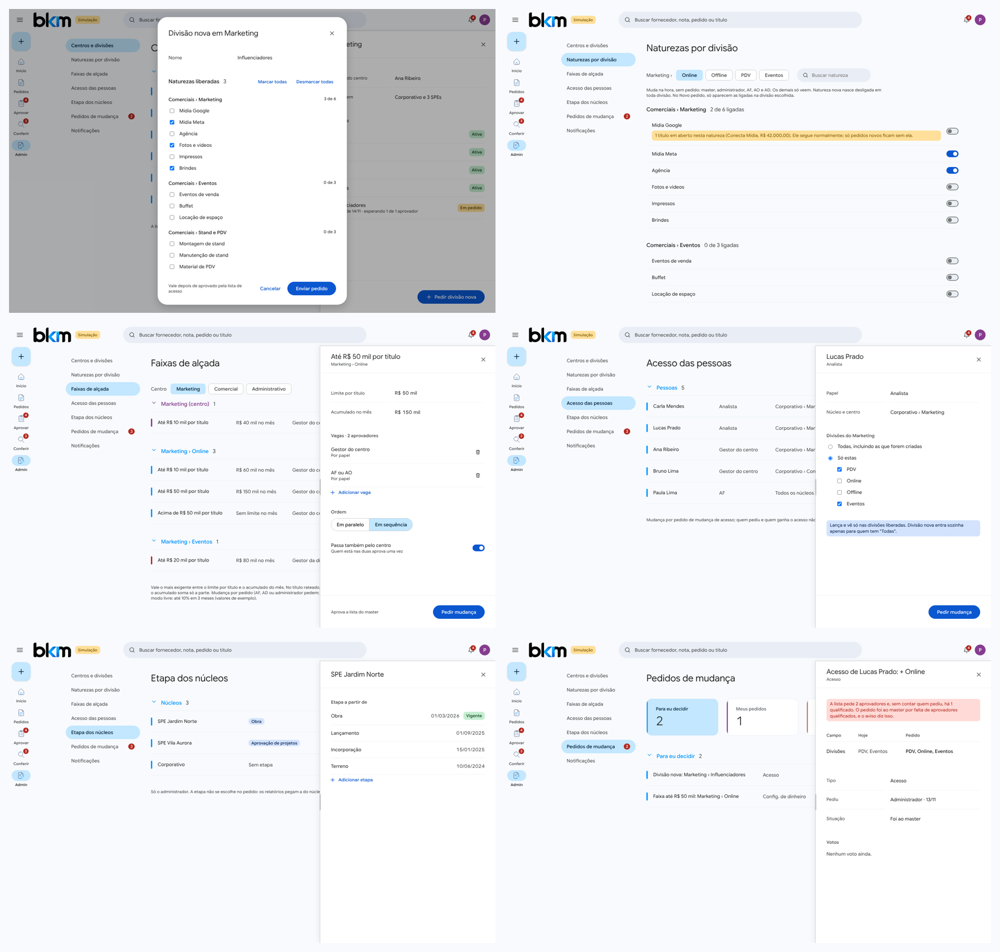
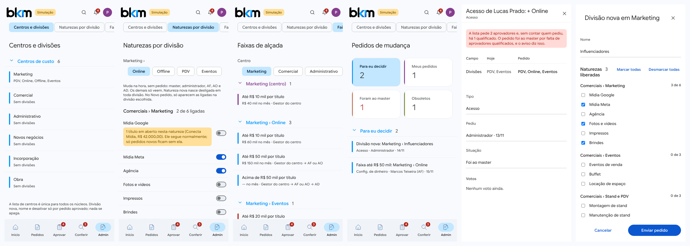

# Aprovações e alçadas

[← Sumário](../README.md)

⏳ **Sessão em andamento** (começou em 7/nov/2026). O Moises pediu que a aprovação seja "amplamente discutida", com várias camadas, alçadas e regras. Nada disso tem tela ainda.

## O que entra agora

✅ **Decidido** (Moises, 7/nov/2026): por ora a aprovação cobre **só o financeiro**:

- a nota ou o título, antes de virar dívida;
- o pagamento ou o lote que vai ao banco;
- o adiantamento e a liberação de caução;
- o orçamento (versão aprovada e reprojeções).

Compras (requisição, cotação, pedido e contrato) fica para depois, no mesmo mecanismo, sem um segundo sistema de aprovação.

## Os cinco momentos de aprovação

✅ **Decidido** (Moises, 7/nov/2026):

| Momento | Quem aprova |
| --- | --- |
| 1. **Título** (nota lançada) | As regras de aprovação (ver abaixo). É a aprovação principal |
| 2. **Adiantamento sem nota** | O mesmo caminho do título, mais o gestor do contrato |
| 3. **Lote, antes de ir ao Nexxera** | Uma conferência final por uma pessoa diferente de quem montou o lote. Ela não reaprova cada título; confere banco, valores e datas |
| 4. **Liberação de caução** | O gestor do contrato e, acima de certo valor, também as regras gerais |
| 5. **Publicação de versão do orçamento** | Diretoria |

✅ **Quem lança não aprova o próprio lançamento** (Moises, 7/nov/2026). Só a AD pode lançar e aprovar, e isso se configura **pessoa a pessoa**: para cada um da AD, diz-se se pode aprovar o próprio lançamento e se deve sair um aviso quando lançar e aprovar o mesmo item (Moises, 7/nov/2026). O lançamento de quem está na AF ou na AO é aprovado, por padrão, pela AD; é configurável trocar por "a AF aprova o da AO e a AO aprova o da AF" ou por uma terceira pessoa que aprova os dois. ✅ Quem inclui ou tira pessoas da AD é o master, ou um administrador com a aprovação do master (Moises, 7/nov/2026).

⏳ Em aberto: o valor a partir do qual a liberação de caução também passa pelas regras gerais.

## Como uma regra de aprovação funciona

✅ **Decidido** (Moises, 7/nov/2026):

- As regras são **editáveis pela tela**, sem programador, e podem ser dadas por núcleo econômico, por centro de custo, por natureza e por quem paga. Exemplo do Moises: uma regra para marketing, outra para obra, outra para comercial.
- **Hierarquia de regras** (Moises, 7/nov/2026). Cada regra tem um nível:
  1. Regras do **mesmo nível** que se encaixam no lançamento **se somam**, e a mesma pessoa não aprova duas vezes.
  2. Uma regra de **nível superior se sobrepõe** às de nível inferior.
  3. Uma regra **supertrunfo** substitui qualquer outra.
  Qualquer regra, inclusive a superior e a supertrunfo, pode ter quantas camadas se quiser, até menos que as gerais. ✅ Os níveis são configurados pelo master ou por um administrador; a regra **supertrunfo** só é criada e alterada pelo master ou por quem ele der esse poder (Moises, 7/nov/2026).
- **Os aprovadores são pessoas, escolhidas pelo nome** em cada regra, e não um papel ("gestor", "diretor"). Decisão do Moises de 7/nov/2026.
- ✅ As pessoas ficam em **listas nomeadas** (por exemplo, "Aprovador Obras SP", com o João), e cada regra aponta para uma lista. Quando a pessoa sai ou tira férias, edita-se só a lista (Moises, 7/nov/2026). 🟡 Proposto também: um substituto nomeado em cada camada. ✅ **Nomear um substituto é um ato que precisa ser aprovado** (Moises, 7/nov/2026).
- ✅ **Todo aprovador, inclusive os substitutos, é nomeado pelo master ou por um usuário com poder de administrador** (Moises, 7/nov/2026).
- **Título rateado:** cada parte do rateio puxa as suas regras, e o título só fica aprovado quando todas forem cumpridas. Exemplo: um título metade Marketing, metade Obra passa pela regra de marketing e pela de obra. A faixa de valor é conferida também pelo total do lançamento, para o rateio não servir para fugir dela.
- **Cada conta é uma pessoa**, inclusive as duas do Moises (a normal e a master) (Moises, 7/nov/2026).

✅ **Tudo configurável ponto a ponto, regra a regra, pela tela** (Moises, 7/nov/2026): quem aprova, as faixas de valor, a ordem das camadas e se basta um ou precisam todos. Os valores iniciais são definidos na [implantação](https://claude.ai/artifact/2U1u689a7Qi3WAvbZAT6n6). O formato de cada regra:

- Além de núcleo econômico, centro de custo, natureza e empresa pagadora, a regra pode filtrar por fornecedor, tipo de compromisso e faixa de valor.
- Cada regra tem **camadas de aprovadores em sequência**, e cada camada diz se basta um aprovador ou se precisam todos.
- Exemplos (ilustrativos): "Marketing acima de R$ 10 mil: Fulana (marketing), depois Moises"; "Obra: engenheiro da obra, depois gestor de obras"; "qualquer pagamento acima de R$ 200 mil: mais o diretor financeiro".

### Regra inicial e papéis de exceção

✅ **Ponto de partida de todas as regras** (Moises, 7/nov/2026): aprovam **juntos o gestor do centro de custo (antes chamado de gestor da área) e o diretor financeiro ou o COO**; ou então **o CEO aprova sozinho**. Hoje o CEO é o Moises. Depois, cada regra pode ser mudada pela tela.

✅ **Aprovadores do centro de custo** (Moises, 8/nov/2026, decidido para as então chamadas áreas): cada centro de custo tem aprovadores escolhidos pelo nome e diz quantos deles precisam aprovar. ✅ Travas, alçadas e aprovações podem ser dadas em qualquer das três dimensões: núcleo econômico, centro de custo e natureza (Moises, 14/nov/2026). Ver [as três dimensões](../financeiro/classificacao.md#três-dimensões-núcleo-econômico-centro-de-custo-e-natureza). 🟡 Proposta: isso se soma à AF, à AO e à AD, sem substituí-las.

✅ **Diretor financeiro (CFO), COO e CEO são posições no sistema, não cargos** (Moises, 7/nov/2026). Cada posição é uma **lista nomeada**, porque quem ocupa a posição no sistema pode não ter o cargo na empresa:

| Lista | Posição | Para que serve |
| --- | --- | --- |
| **AF** (Aprovação financeira) | a do diretor financeiro (CFO) | Aprova junto com o gestor do centro de custo; recebe exceções |
| **AO** (Aprovação operacional) | a do COO | Aprova junto com o gestor do centro de custo; recebe exceções |
| **AD** (Aprovação definitiva) | a do CEO, hoje o Moises; pode ter mais de uma pessoa | Aprova sozinho; última instância |

Essas listas cuidam das **exceções**: férias sem substituto, demora na aprovação e casos parecidos.

✅ **Pedido parado** (Moises, 7/nov/2026):

- Os **lembretes são automações configuráveis**: notificação, e-mail, aviso a outras pessoas. O primeiro sai, por padrão, no **3º dia** sem resposta.
- Depois de **7 dias corridos** (prazo configurável), **só a camada parada** pode ser decidida por alguém da AF, da AO ou da AD. Esperar não serve para pular as outras camadas, e quem lançou nunca decide.
- O aprovador original continua podendo aprovar até alguém decidir.
- **A AD pode aprovar sozinha a qualquer momento**, sem esperar o prazo.
- O prazo pode ser diferente em cada camada; a exceção pede justificativa; o aprovador que foi passado para trás recebe aviso.

✅ **Camadas com quantos aprovadores quiser** (Moises, 7/nov/2026): uma camada pode ter 2 aprovadores ou mais, e a regra diz se eles precisam seguir uma ordem ou não. A AD pode entrar na sequência como última instância.

✅ **Quando o gestor do centro de custo também está na AF** (Moises, 7/nov/2026): ao colocar a pessoa na AF, o sistema percebe o conflito e pergunta se ela aprova sozinha nesses casos ou se outra pessoa aprova junto, e quem.

✅ **Pagamento que não se encaixa em nenhuma regra** (Moises, 7/nov/2026):

- Vai para a posição do COO sozinha, para a do CFO sozinha ou para as duas juntas. A escolha é uma configuração.
- Se uma das duas listas estiver vazia, vai só para a outra. Se as duas estiverem vazias, vai para o CEO.
- Chega com o aviso **"sem regra"**, para quem recebe analisar e, se for o caso, transformar o caso em regra e atribuir o aprovador.
- Nenhum pagamento sai sem aprovação por falta de regra.

✅ **Substitutos: tudo configurável** (Moises, 7/nov/2026):

- A vigência (início e fim), o que acontece quando o aprovador sai da empresa, se a troca vale só para pedidos novos e quem cobre a vez enquanto a nomeação espera aprovação.
- Quem aprova a nomeação e quem cobre a vez: AF, AO, AD, o master ou alguém que o master designar, combinados como se quiser (por exemplo, AF e AO juntos ou separados).
- O substituto nunca é quem lançou o item (trava fixa).

### Tarefa: criar uma regra de aprovação

> ⏳ As telas ainda não existem. A configuração é do master e dos administradores; a supertrunfo, só do master ou de quem ele autorizar.

1. Abra **Configurações › Aprovação › Regras** e clique em **Nova regra**.
2. Escolha o **momento**: título, adiantamento sem nota, lote, liberação de caução ou orçamento.
3. Dê um nome (por exemplo, "Marketing acima de R$ 10 mil").
4. Em **Condições**, escolha o que a regra pega. Todas são opcionais: empresa pagadora, núcleo econômico, centro de custo, galho da natureza (vale para tudo abaixo dele), fornecedor, tipo de compromisso e faixa de valor.
5. Em **Camadas**, inclua a primeira camada: escolha a lista de aprovadores e se basta um ou precisam todos.
6. Se houver mais camadas, inclua na ordem em que devem aprovar.
7. Escolha o **nível**: comum (soma com as do mesmo nível), superior (se sobrepõe às de nível inferior) ou supertrunfo (substitui qualquer outra).
8. Salve. A regra vale para os pedidos novos.

**O que o sistema confere:** a regra precisa ter pelo menos uma camada; quem lança não aprova o próprio lançamento, salvo a AD.

**Se nenhuma regra pegar o item:** ele vai para as posições de exceção com o aviso "sem regra" (ver [Regra inicial e papéis de exceção](#regra-inicial-e-papéis-de-exceção)).

### Limites do administrador

✅ **Decidido** (Moises, 7/nov/2026):

1. O administrador **não pode se colocar** numa lista de aprovadores nem se nomear substituto.
2. O administrador **não pode mudar uma lista da qual faz parte**.
3. **Só o master dá e tira** o poder de administrador.
4. **A cada trimestre, o master revisa** as listas de aprovadores e quem é administrador (Moises, 7/nov/2026; antes era mensal).

### Tarefa: trocar o aprovador de uma lista

> ⏳ As telas ainda não existem.

1. Abra **Configurações › Aprovação › Listas de aprovadores**.
2. Abra a lista (por exemplo, "Aprovador Obras SP").
3. Tire a pessoa que sai e inclua a nova. Só o master ou um administrador pode fazer isso.
4. Salve. Todas as regras que apontam para essa lista passam a usar a pessoa nova.

### Exemplo de soma

Um gasto de marketing de R$ 300 mil, com as regras acima, passa pelo gestor de marketing, pela diretoria e pelo diretor financeiro. Se o diretor financeiro também estiver na diretoria, ele aprova uma vez só.

## Pagamento de funcionários PJ

✅ **Já vale agora, com o Sienge** (Moises, 7/nov/2026): os títulos dos fornecedores PJ copiados do Sienge ficam numa **área restrita** do ERP BKM. Relatórios e BI mostram só a soma por núcleo econômico e mês, sem valor por pessoa. Os centros de custo pequenos **não** são juntados (Moises, 7/nov/2026). Consequência: num centro de custo com um PJ só, a soma do mês é o valor dele. No próprio Sienge, nome e valor continuam visíveis.

✅ Desde 18/nov/2026 (Moises), o título PJ tem uma aprovação: a do **master** ou de quem ele designou para o PJ. Os dois "ok" do mês sobre as tabelas continuam (Moises, 18/nov/2026): um do **RH**, que confere tudo menos a remuneração, e um do **master**, que confere a remuneração. Ainda sem código.

✅ **O cadastro do PJ (nome, CPF, e-mail, telefone) só o master e quem ele designou veem** (Moises, 19/nov/2026). Quem vê o PJ cadastra a pessoa já como PJ; depois, só o master tira ou põe essa marca. Os demais não acham a pessoa na lista de fornecedores nem conseguem lançar nada para ela.

✅ **O pagamento de PJ sobe sozinho** (Moises, 18/nov/2026: "salário só pode subir sozinho"): o título, a nota ou o contrato com natureza de PJ não pode ter outra natureza junto. Quem tentar pôr uma linha PJ ao lado de uma linha comum (ou o contrário) recebe o aviso "O pagamento de PJ sobe sozinho". ⏳ A conferência do valor da nota do PJ entra com o cadastro da remuneração, que ainda não existe. Quando entrar: a nota com valor diferente do aprovado, para mais ou para menos, **não é recusada**; vai para a aprovação do master (Moises, 18/nov/2026).

> 🔜 **Futuro.** Os pagamentos PJ ainda passam pelo Sienge, e a remessa e o extrato vão pelo Nexxera (Moises, 7/nov/2026). Enquanto for assim, o nome e o valor de cada PJ continuam visíveis no Sienge, e **todo o fluxo abaixo (anonimização, conferência com dois "ok", portal de notas e portal do contador) fica para quando o Sienge sair desse fluxo**. Ver [O que ainda é feito à mão no Sienge](passos-manuais-no-sienge.md). A conciliação automática depende do módulo de Bancos, que não foi desenhado.

**Para que serve:** pagar os funcionários contratados como PJ mantendo o valor de cada um o mais anônimo possível.

✅ **Pedido e decisões do Moises** (7/nov/2026):

- O **RH** mantém, no portal dele, quem está ativo, o controle dos benefícios e **qual SPE paga cada funcionário em cada mês**.
- Uma **tabela de remuneração**, à parte, guarda o valor de cada um "a 7 chaves".
- O **financeiro** vê só um pseudônimo (por exemplo, "PJ-017") e o valor a pagar, nunca o nome.
- O funcionário sobe a nota num **portal**; se tudo bate com as duas tabelas, ela segue direto para pagamento.
- O RH pode **dividir o pagamento de um funcionário entre núcleos econômicos (SPEs) ou centros de custo**, em percentuais, no mês (Moises, 7/nov/2026). O PJ emite uma nota para cada SPE. Ao receber cada nota, o sistema confere o CNPJ da SPE, o percentual e o valor contra o cadastro do RH daquele mês, e **trava o pagamento** se algo divergir.
- **Todo mês, as duas tabelas são conferidas.** Se um dos dois responsáveis não der o "ok" do mês, **ninguém recebe**.
- Os dois responsáveis e os **substitutos temporários** de cada um são definidos na própria plataforma.
- Existe **um único usuário master, o Moises** (com uma conta própria de master, separada da conta do dia a dia). Ele vê tudo, pode trocar o aprovador e pode aprovar tudo, inclusive os dois "ok" do mês.
- **Qualquer mudança de remuneração** de um PJ passa por aprovadores definidos (Moises, 7/nov/2026).
- A folha PJ entra no financeiro, nos relatórios e no BI **somada por núcleo econômico e por mês**, sem valor por pessoa. O detalhe fica só na área restrita.
- As **notas dos PJ ficam guardadas na área restrita** ("a 7 chaves") e vão direto ao contador. O contador também tem um **portal** para baixá-las. ✅ O contador entra nesse portal com um login próprio, fora do Google (Moises, 7/nov/2026).

🟡 **Propostas** ainda sem resposta (7/nov/2026):

- Conciliação automática: o extrato vem direto do banco e, antes de qualquer pessoa ver, os dados do PJ são trocados pelo pseudônimo. O Moises sugeriu a ideia; o desenho depende do módulo de Bancos.
- O pseudônimo é um código aleatório, e não um "hash" do CPF, que se descobre testando todos os CPFs.
- Ninguém do financeiro digita o Pix nem entra no internet banking da conta usada para os PJ, que seria uma conta separada; o lote vai ao banco pela integração.
- Toda leitura do master fica registrada. (A sugestão de dois masters foi recusada: o master é só o Moises.)
- Aviso aos responsáveis alguns dias antes do vencimento.
- A chave Pix não aparece para o financeiro: ela só é buscada na hora de mandar o pagamento ao banco.
- O portal do contador tem login próprio, mostra só as notas e registra cada download.

**O que não dá para garantir:** o anonimato total. A chave Pix, o extrato e o comprovante do banco e a nota que vai ao contador identificam a pessoa. O que o sistema garante é que quase ninguém veja, e que toda leitura fique registrada.

⚠️ **Ponto levantado e sem resposta:** registrar benefícios de PJ no sistema pode servir de prova de vínculo empregatício. A sugestão é passar o desenho pelo jurídico antes.

### Tarefa: conferir e liberar o pagamento dos PJ do mês

> ⏳ As telas ainda não existem.

1. **Responsável do RH:** abra **Pessoal › Conferência do mês**, confira quem está ativo, os benefícios e qual SPE paga cada um neste mês, e clique em **Dar ok**.
2. **Responsável pela remuneração:** abra a mesma tela, confira os valores e clique em **Dar ok**.
3. Com os dois "ok", as notas que os PJ subiram no portal e que batem com as tabelas seguem para pagamento.
4. **Financeiro:** vê os pagamentos só pelo pseudônimo e o valor.
5. **Contador:** recebe as notas e, se precisar, baixa pelo portal dele.

**Se der errado:** se um responsável estiver ausente, o substituto temporário dá o "ok". Se nenhum dos dois puder, o master pode aprovar ou trocar o aprovador.

## Outras regras já decididas

- ✅ A aprovação será um **módulo único**, usado por todos os outros (contrato, medição, nota, pagamento, caução, reclassificação), e não uma regra espalhada em cada tela (7/nov/2026).
- ✅ As regras podem ser dadas sobre **qualquer combinação de classificações**, e a regra num galho vale para tudo abaixo dele. Exemplos (7/nov/2026):
  - "Comerciais › Marketing, em qualquer empreendimento, acima de R$ 20 mil: aprova o diretor comercial."
  - "Empreendimento Vila Maria, qualquer natureza: aprova o gestor da obra."
- ✅ O mesmo mecanismo serve para **restringir quem vê**: "Gerais › Pessoal › Folha: só RH e diretoria"; "o sócio externo da SPE X só vê a SPE X".
- ✅ A medição continua com a aprovação de **2 gestores**, que passa a ser feita no ERP BKM (processo atual da BKM, 6/nov/2026).
- ✅ Alçadas de reclassificação: idade × valor × acumulado no mês, vale a mais alta (ver [Reclassificação](../financeiro/reclassificacao-e-fechamento.md)).
- 🟡 A autorização de pagamento no Sienge continua como o último clique do financeiro, porque não tem API; a aprovação de verdade acontece no ERP BKM.

## Papéis previstos

✅ **Usuário master** (Moises, 7/nov/2026): existe um só, o Moises, que pode ver e aprovar tudo. Ele terá **duas contas**: uma normal, para o dia a dia, e uma de master, usada só quando precisar desse poder.

🟡 Pelo banco de dados de 7/nov/2026: diretor, gestor, analista e leitura; à parte, administrador (configuração) e contador (vota nas alçadas que pedem o contador). Segue o modelo do BKM Terrenos, com hierarquia analista → gestor → diretor.

## Alçada de pagamento do piloto (Marketing)

✅ Decidida pelo Moises em 14/nov/2026; no banco desde o PR #14.

- **Onde vale:** no piloto, Marketing. A alçada vale para todo título a pagar e toda previsão lançada à mão, em todo centro de custo.
- ✅ **Nada é aprovado sem aprovador** (Moises, 18/nov/2026): centro sem gestor da área e sem faixas próprias **não aprova sozinho**. Ele segue as faixas gerais; a fase do gestor, que o centro não tem, vai ao **master**, com aviso de falta de aprovadores. Antes, o título desse centro ficava fora da alçada e a previsão nascia aprovada.
- ✅ **Imposto, sócios e linha sem centro também passam por aprovação** (Moises, 18/nov/2026), em qualquer valor:
  - título de **imposto retido**: aprovação da **AF**;
  - título de **movimento entre sócios** (a parte a pagar): aprovação da **AD**;
  - linha **sem núcleo e sem centro** (como 10.01 Bens da empresa, que hoje só o master lança): **AF e AO juntos**, em qualquer ordem, **ou a AD sozinha**. Vale também para a previsão sem centro. O título que tem linhas com centro e sem centro passa pelas duas aprovações.
- ✅ **PJ só com o master e quem ele designar** (Moises, 18/nov/2026). O título ou a previsão com alguma linha de natureza restrita (folha PJ, pró-labore) tem uma aprovação só, a do **master ou de um designado**, em qualquer valor. AF, AO, AD, diretor e gestor da área não veem nem aprovam. O PJ **não entra no acumulado do mês** do centro (escolha do Moises, 18/nov/2026), e os avisos sobre ele só vão a quem vê o PJ. A previsão PJ **não vai ao Sienge** como PRV. O título PJ aprovado ainda vai ao Sienge para ser pago, e lá quem tem acesso ao financeiro o vê (limitação da transição).
- ✅ **A AD sempre pode fazer a aprovação da AF ou da AO** (Moises, 18/nov/2026). Quando a mesma faixa tem a vaga da AD e a da AF, quem está na AD aprova primeiro na vaga dela.
- Recusar o título de imposto cancela a nota inteira, como recusar o título do fornecedor.
- **Acumulado:** o do **mês de competência**, por centro de custo, somando todos os núcleos e empresas, já contando o próprio título.
- **Faixas:**
  - até R$ 50 mil no acumulado: aprovam o gestor da área e depois a AF;
  - acima de R$ 50 mil: aprovam o gestor da área, depois a AF e depois a AD. Vale para o título que passa dos 50 mil e para todos os seguintes do mês.
- ✅ O acumulado soma também o que **o mesmo fornecedor** tem no mês em outros centros de custo, para não escapar da alçada repartindo o gasto. O administrador pode desligar (Moises, 14/nov/2026).
- **Configuração:** as faixas e o modo de somar (grupo, empresa ou núcleo) são valores iniciais; o administrador muda, com registro.
- **Regras do código** (a conferir com o Moises): a alçada é fixada na confirmação do título, e um título lançado depois não muda a de um anterior; as fases de aprovação correm em sequência; quem lançou não aprova e cada pessoa aprova uma fase de aprovação só; sem a alçada completa, o título não é pago; quem aprova vê os títulos do mês que formaram o acumulado.
- **Imposto retido** pede a AF; **movimento entre sócios** pede a AD (desde 18/nov/2026).

**Alçada por centro de custo** (Moises, 15/nov/2026; no código a partir do PR #37):

- ✅ Cada centro de custo pode ter **faixas próprias**; o que não tem usa as gerais.
- ✅ Cada faixa tem dois limites: o **valor do título** e o **acumulado do mês no centro**. Vale a faixa mais exigente das duas contas.
- ✅ O número de aprovadores é o número de **vagas** da faixa. Uma vaga é um papel (gestor da área, diretor da área, AF, AO, AD) ou uma pessoa pelo nome, sem precisar de cargo. As vagas andam em sequência ou em paralelo.
- ✅ A mesma pessoa não ocupa duas vagas; o administrador não aprova; quem lançou não aprova (salvo a pessoa da AD com a marca de aprovar o próprio).
- ~~No rateio em vários centros, vale o centro com mais vagas~~ (substituído em 15/nov/2026, 13h20). ✅ No rateio em vários centros, **cada centro tem uma aprovação separada**, com o valor que cabe a ele e o rito daquele centro (o limite por título olha o **valor inteiro do título** em cada centro, para que dividir no rateio não baixe a faixa; o acumulado do mês é o de cada centro; Moises, 15/nov/2026). Quem tem vaga em mais de um centro aprova em cada um. O título só fica aprovado quando todos os centros aprovaram, e quem lançou e quem aprova veem que centros e que vagas ainda faltam. O voto do master aprova todos os centros de uma vez.
- ✅ Se faltam aprovadores qualificados, o título vai ao Moises, com o aviso de que veio por falta de aprovadores mínimos qualificados. Quem passar a ocupar a vaga depois também pode aprovar.
- ✅ O último diretor da área não sai enquanto houver título esperando por ele.
- ✅ A AF e a AD podem mexer no limite do título no modo livre, como no limite do acumulado. Mudar as vagas ou o paralelo sempre pede aprovação.

**Aprovar, recusar ou pedir revisão** (Moises, 14/nov/2026). Cada fase de aprovação da alçada tem as três saídas:

- ✅ **Recusar** exige justificativa e **cancela o título**. Se o título é de uma nota, cancela a nota inteira, com os impostos retidos; a previsão e a caução voltam, e o número da nota fica livre para ser lançado de novo.
- ✅ **Pedir revisão** exige o motivo. O título fica aberto, mas ninguém aprova nem paga até ele ser reenviado. Podem ajustar quem lançou, o gestor da área e a AF. No título avulso, muda-se o título, as parcelas e o rateio; no título de nota, muda-se a nota.
- ✅ **Reenvio:** a aprovação recomeça, mas **quem ajustou ou reenviou já aprova a própria fase de aprovação** na volta nova: a gestora da área aprova a fase da área, a AF aprova a fase da AF. Quem lançou continua sendo o autor, e o título segue para a próxima fase de aprovação que falta. Quem ajustou não aprova nenhuma outra fase (Moises, 14/nov/2026, 21h35; substitui a leitura anterior de que quem reenvia não aprova a volta).
- ✅ Cada mudança do ajuste fica registrada com quem fez, o valor de antes e o de depois. Linha nova (uma parcela, uma linha de rateio) segue a regra de cada campo.
- ⏳ Futuro (Moises): por ora esses passos são fixos. Depois ele quer cadastrar fluxos de aprovação e ligar cada um a um processo ou área.
- ✅ **O que se pode ajustar:** o administrador define, por campo e por papel, se o campo pode mudar e, nos números e datas, se só para mais, só para menos ou para os dois lados. Começa tudo liberado.

## Pagamento com multa ou juros

✅ **Decidido** (Moises, 7/nov/2026): pagar com multa ou juros é "falha grave, desperdício por desorganização". Por isso, **o título com multa ou juros precisa de uma aprovação específica**, somada às regras normais, de uma pessoa definida pelo administrador. Por padrão, essa pessoa é a AD.

✅ Também confirmados (Moises, 8/nov/2026, "Concordo"):

- Tolerância zero: um centavo de multa ou juros já pede essa aprovação.
- Vale também para o título já vencido, mesmo quando a multa só aparece no banco; sem isso, o boleto vencido passaria pelo lote sem a aprovação extra.
- O motivo do atraso é obrigatório.
- Um relatório mensal mostra a multa e os juros pagos por centro de custo e por responsável.

## Travas fixas

✅ **Confirmadas pelo Moises** no [documento de desenho das aprovações](https://claude.ai/artifact/FvkBaLmYig68zstJzTKFwP) (7/nov/2026). Ficam no banco de dados, e **nenhuma tela as desliga**, nem a do master:

1. Quem lança não aprova, salvo a pessoa da AD que o master autorizou.
2. Nas camadas em conjunto, cada camada tem uma pessoa diferente, salvo a exceção "gestor do centro de custo também na AF ou na AO" escolhida na configuração.
3. O administrador não se nomeia aprovador nem substituto.
4. O substituto não é quem lançou.
5. A aprovação vale só para o que foi aprovado, **inclusive a conta bancária e o PIX do fornecedor**. Se o título, os dados bancários ou o arquivo do lote mudarem depois, é preciso aprovar de novo.
6. **Trocar os dados bancários de um fornecedor** é um ato que outra pessoa aprova. O fornecedor é avisado pelo contato que já estava cadastrado, e os títulos abertos dele voltam para aprovação. (É o golpe mais comum: um e-mail falso pedindo a troca da conta.)
7. O lote só aceita título aprovado e sem nenhuma mudança depois da aprovação.
8. Todo pagamento tem pelo menos uma aprovação. No PJ, a do master ou de quem ele designou (desde 18/nov/2026).
9. Toda mudança de configuração fica registrada.

✅ Travas novas, autorizadas pelo Moises em 14/nov/2026 (S-053 a S-055), também no banco e sem tela que as desligue:

- ~~Só o administrador cadastra e altera as contas bancárias da empresa~~ (14/nov). Desde 15/nov, **só o master** (ver abaixo). Tudo fica na auditoria. Usuários: ver [Mudanças de acesso](#mudanças-de-acesso-e-sucessão-do-master) (regra de 14/nov à noite).
- **Ninguém muda o próprio papel, acesso ou login**, nem o administrador.
- O mês só fecha e reabre pelas funções da diretoria (ver [Fechamento](../financeiro/reclassificacao-e-fechamento.md)).
- Orçamento publicado não se edita (ver [Orçamento](../financeiro/orcamento-e-fluxo-de-caixa.md)).

✅ Mais travas autorizadas pelo Moises em 14/nov/2026 (S-056 a S-058):

- Rateio, previsão, orçamento e pagamento só usam **núcleo econômico da mesma empresa** do registro.
- Depois de criado, contrato, nota, título, orçamento, pagamento ou conta **não muda de empresa**: cria-se outro.
- **Título criado à mão é sempre avulso**, sem nota e sem contrato. Os títulos de nota, de imposto retido, de caução e de movimento entre sócios só nascem pelas operações do sistema.
- Com a nota lançada, **o rateio e as retenções dela não mudam**. Com caução retida, o rateio do contrato também não muda.
- **Movimento entre sócios** não se altera nem se apaga.
- A **reclassificação** só é pedida por quem tem cadastro no ERP, e só quem pediu pode cancelar.

## Quem muda a configuração

- ✅ **Por ora, a configuração de dinheiro e aprovação só o master muda**; o administrador (TI) não muda. Inclui: alçadas de pagamento e de reclassificação, níveis de aprovação, regra do adiantamento e da alçada, regras de ajuste da revisão, naturezas do sistema, contas bancárias da empresa e códigos do Sienge (Moises, 15/nov/2026). Onde as linhas abaixo dizem "o master ou um administrador", vale agora só o master.
- ✅ **Pedidos de mudança na configuração de dinheiro** (Moises, 15/nov/2026): a AF, a AD e o administrador pedem a mudança, com motivo. Aprova a **lista de aprovadores de cada tabela**, que só o master define, com o mínimo de votos. Quem pediu não aprova; o master aprova qualquer pedido. Cada tabela fica em **sempre com aprovação** ou, nas faixas de alçada, **livre até X% a cada N meses**: a AF ou a AD muda o valor da faixa sem aprovação se ficar a até X% do valor de N meses atrás. O percentual e o período são configuráveis; 10% a cada 3 meses é só o valor inicial (Moises, 15/nov/2026). Tirar fase de aprovação, criar ou tirar faixa, conta bancária e código do Sienge sempre passam por aprovação. Toda mudança avisa o Moises.
- ✅ O pedido do administrador nunca é livre. Se a lista não tem pessoas suficientes além de quem pediu, o pedido vai para o master (Moises, 15/nov/2026).
- ✅ **Pagamento e baixa** só registram o financeiro (AF, AO, AD), o master e a ligação automática com o Sienge (Moises, 15/nov/2026).

- ✅ **Listas AF e AO:** qualquer pessoa da AD pode mexer, menos numa lista da qual ela mesma faça parte. Toda mudança avisa o master e as outras pessoas da AD (Moises, 7/nov/2026).
- ✅ **Prazos e opções** (demora, lembretes, destino do "sem regra", prazo da nota do adiantamento): o master ou um administrador (Moises, 7/nov/2026).
- ✅ **Lista AD:** o master, ou um administrador com a aprovação do master.
- ✅ **Mudanças de configuração** valem só para os pedidos novos e avisam o master. As que afrouxam o controle (menos camadas, faixa maior, tirar uma natureza da aprovação) precisam do master. A tela mostra o efeito antes de salvar (Moises, 7/nov/2026).
- ✅ **Duas alçadas de valor**, ambas configuráveis: o valor da operação e o acumulado no mês (Moises, 7/nov/2026).

✅ Também confirmados no documento de desenho (7/nov/2026): as duas opções de cada pessoa da AD só o master muda, e todo lançamento aprovado por quem o lançou fica marcado e entra na revisão do master; um relatório mostra os pagamentos que caíram em "sem regra"; no lote, a conferência grava a "impressão digital" do arquivo, para saber se ele mudou.

### As telas do Admin

> ✅ Telas aprovadas pelo Moises em 15/nov/2026 (protótipo, versão 35), ainda sem código. As imagens são de versões um pouco anteriores.

O item **Admin** do menu tem sete seções. A seção Etapa dos núcleos, que aparece na imagem, sai, porque a etapa do empreendimento saiu do sistema (Moises, 15/nov/2026).

| Seção | O que faz | Quem muda e como |
| --- | --- | --- |
| **Centros e divisões** | Lista os centros e as divisões. O pedido de divisão nova já leva as naturezas liberadas, com Marcar todas e Desmarcar todas. | O administrador pede; vale depois de aprovado pela lista de acesso. |
| **Naturezas por divisão** | Uma chave por natureza em cada divisão. Ao desligar, avisa os títulos em aberto que estão nela. | Master, administrador, AF, AO e AD, na hora, sem pedido. Os demais só veem. |
| **Faixas de alçada** | As faixas de cada centro e de cada divisão, com o limite por título, o acumulado do mês, as vagas, a ordem (em paralelo ou em sequência) e a opção "passa também pelo centro". | Por pedido de mudança. |
| **Acesso das pessoas** | O papel, o núcleo e o centro de cada pessoa, e as divisões: todas (incluindo as que forem criadas) ou só algumas. | Por pedido de mudança de acesso. |
| **Etiquetas** | As etiquetas, com quantos títulos usam cada uma. Cria, renomeia e desativa. | Só a AF, a AD e o master, na hora. |
| **Pedidos de mudança** | Os pedidos para você decidir e os seus, com o que muda (hoje e pedido), quem pediu, a situação e os votos. Mostra quando o pedido foi ao master por falta de aprovadores. | Decide quem está na lista de aprovadores do tipo de pedido. |
| **Notificações** | O painel de avisos (ver [Notificações](notificacoes.md)). | Ver a página de notificações. |

## Mudanças de acesso e sucessão do master

✅ Decidido pelo Moises em 14/nov/2026:

- **Toda mudança de acesso fica pendente até ser aprovada.** Vale para modelos, atribuições, exceções, gestor e diretor da área, AF, AO, AD, tipos de núcleo, marca de natureza restrita (esta só com a aprovação do master, mesmo que as outras sejam dispensadas) e mudança do tipo de um núcleo.
- Aprovam os **aprovadores de acesso**, uma lista configurável com um mínimo de aprovações. Quem pediu e quem ganha o acesso não aprovam.
- **O master** muda a lista de aprovadores sozinho; os outros só a mudam com a unanimidade da própria lista. Só o master cria e administra administradores, e só ele define o grupo de sucessão.
- **Tudo o que o master faz vale na hora**, sem aprovação. Ele escolhe, tipo a tipo, quais mudanças de acesso pedidas pelo administrador precisam de aprovação; todas começam exigindo.
- **O administrador é o TI e não aprova nada.** Ele não entra na AF, na AO, na AD, como gestor ou diretor da área, nos aprovadores de acesso nem no grupo de sucessão.
- **Usuários:** o usuário novo **nasce inativo**; o administrador pede a ativação, aprovada conforme o nível do papel (abaixo). Papel e contador mudam por pedido aprovado ou pelo master. Login, desativar, reativar, apagar e usuário de sucessão: só o master. Ninguém muda o próprio cadastro, nem o master (Moises, 14/nov/2026, 21h; antes "nasce como leitura").
- **AF, AO e AD:** só com a aprovação do master.
- **Quem aprova cada nível de papel** (o master configura): para leitura, analista, gestor, diretor, contador, gestor da área e diretor da área, o master escolhe entre **Nenhuma** (vale na hora), **Delegado** (basta um dos delegados que ele escolheu), **Lista** (todos os aprovadores de acesso) ou **Master** (só ele). Valores iniciais: leitura e analista no Delegado; gestor, contador e as áreas na Lista; diretor no Master.
- **O master sempre basta:** um voto dele aprova qualquer pedido de acesso; num título, aprova de uma vez todas as fases de aprovação que faltam (exceção à regra de uma fase por pessoa); numa reclassificação, aprova sozinho. Quem lançou ou pediu não aprova, nem o master.

**Sucessão do master:**

1. O grupo de sucessão pode ter usuários só para isso, inclusive familiares de fora da empresa, sem nenhum outro acesso.
2. O pedido de sucessão já aponta quem será o novo master.
3. A unanimidade do grupo não tem prazo.
4. Depois da unanimidade, o master tem **7 dias para vetar**, contados do **primeiro aviso enviado** a ele (sem aviso enviado, a sucessão não corre), e recebe 2 avisos por dia, por e-mail e WhatsApp. Cada aviso traz um link para uma página com o botão **Interromper** (um clique).
5. Sem veto, o novo master assume.

## Remuneração variável (comissões, prêmios, sorteios)

✅ **Decidido** (Moises, 7/nov/2026, no documento de desenho). O caminho do pagamento depende de **quem recebe**:

| Quem recebe | Como se paga |
| --- | --- |
| Funcionário CLT | Pela folha, com imposto retido. Nunca por PIX direto da conta da empresa |
| PJ | Entra no valor do mês, coberto pela nota |
| Corretor autônomo | Por RPA, com as retenções |
| Imobiliária | Com nota fiscal |

- Cada **campanha** (de meta, de vendas, de evento) é cadastrada antes, com o orçamento aprovado pelas regras.
- Paga-se **só a pessoas cadastradas**, nunca a uma chave PIX solta. Pelo vínculo da pessoa, o sistema escolhe o caminho da tabela.
- Um relatório mostra quanto cada pessoa recebeu no mês.
- 🟡 Para prêmio pequeno em evento, uma alternativa é vale-presente comprado com nota. A forma de cada caso, e as regras de sorteio, o contador confirma.

## O que falta decidir

- Se o Nexxera ou o banco exigem assinatura eletrônica da remessa, de quem e quantas (pergunta ao financeiro).
- As faixas de valor de cada regra ficam para a [implantação](https://claude.ai/artifact/2U1u689a7Qi3WAvbZAT6n6).
- As avaliações e a aprovação para liberar caução.
- Alçadas de pagamento.
