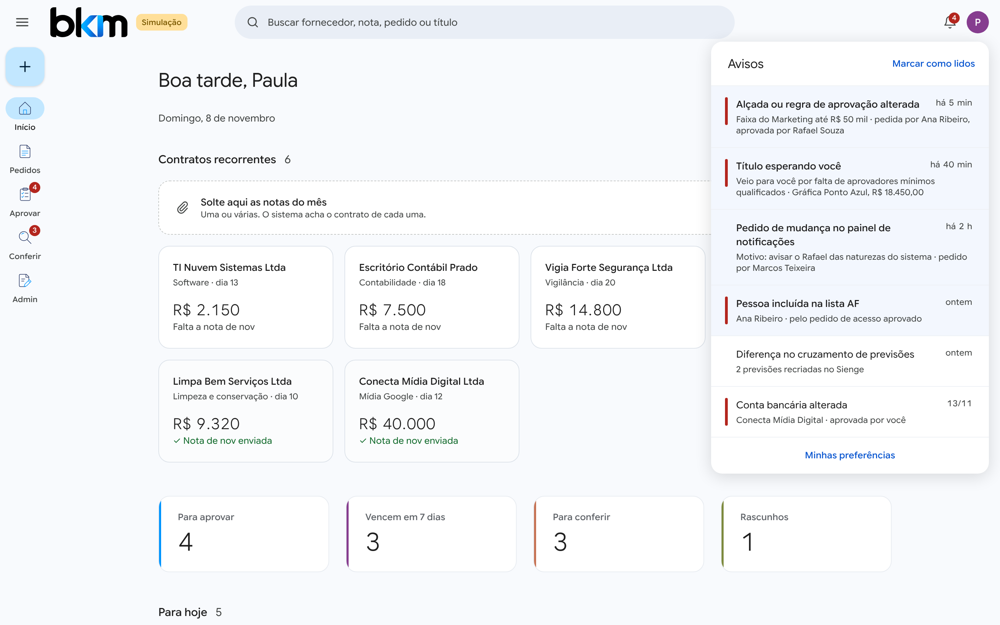
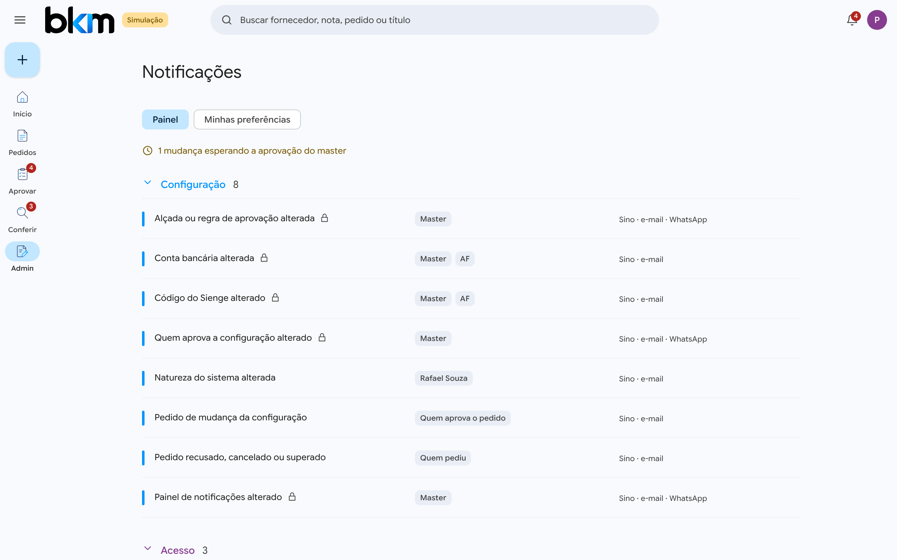
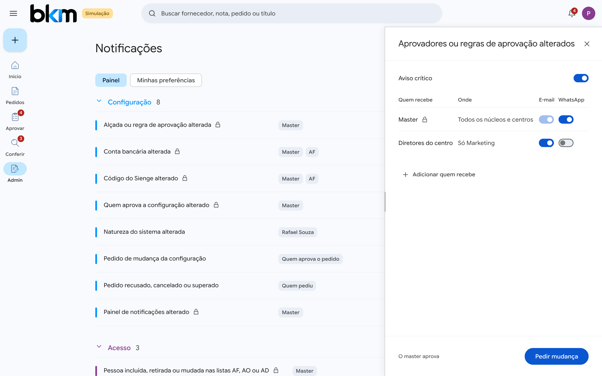
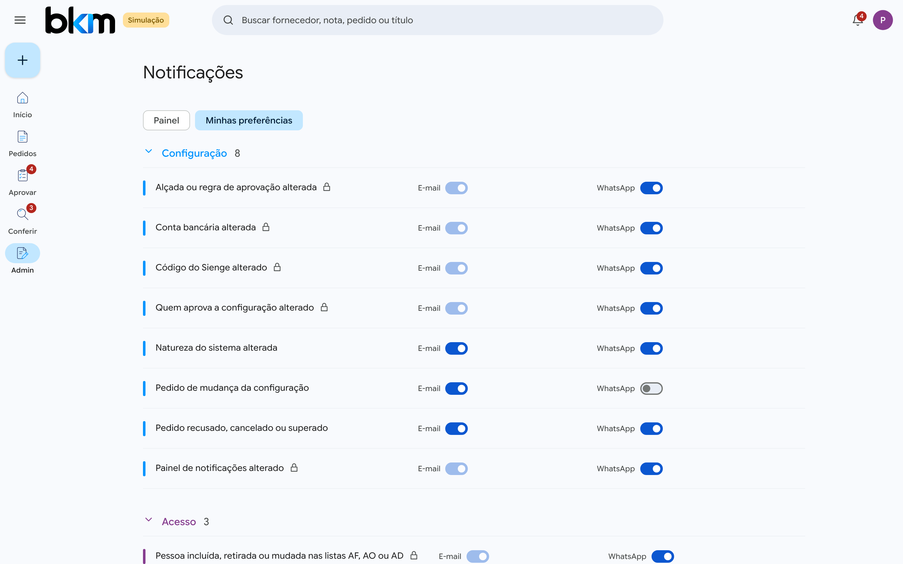

# Notificações

Os avisos do sistema chegam pelo sino e, conforme a regra, por e-mail e WhatsApp. ✅ Decisões do Moises de 15/nov/2026; no código a partir do PR #40, ainda sem tela.

## Quem recebe cada aviso

- ✅ Um **painel** diz quem recebe cada tipo de aviso. O destino pode ser uma pessoa, um papel, uma lista (AF, AO, AD), o gestor ou os diretores do centro de custo, quem fez o pedido, quem aprova o pedido, os administradores ou o master.
- ✅ Cada regra pode valer só para um núcleo econômico ou um centro de custo, e diz se o aviso vai também por e-mail e WhatsApp. O sino recebe sempre.
- ✅ Ninguém recebe aviso do que não pode ver (núcleo e centro). Quem fez a ação não é avisado dela.
- ✅ Quando um pedido vai ao master por falta de aprovadores qualificados, o aviso diz isso.

## Avisos críticos

- ✅ Aviso crítico vai **sempre ao master**. Ninguém o desliga no sino nem no e-mail; só no WhatsApp.
- ✅ São críticos: mudança de alçada; conta bancária; código do Sienge; quem aprova a configuração; entrar, sair ou mudar alguém nas listas AF, AO e AD; aprovadores e regras de aprovação; administrador criado ou retirado; e o próprio painel de avisos.
- ✅ Cada pessoa desliga para si o e-mail e o WhatsApp dos avisos que **não** são críticos.

## Quem mexe no painel

- ✅ O administrador pede a mudança no painel ou na lista de avisos críticos, e o master aprova. O master também muda direto e pode delegar essa aprovação.

## As telas

🧪 Protótipo da linha F, ainda **não aprovado** pelo Moises (15/nov/2026).

| Tela | O que mostra |
| --- | --- |
| **Sino** (no alto) | Os avisos, com uma faixa vermelha nos críticos, "Marcar como lidos" e o link para Minhas preferências |
| **Admin › Notificações › Painel** | Os eventos agrupados por módulo; cada linha com quem recebe (em chips) e os canais. Os críticos têm cadeado. Com pedido pendente, aparece "1 mudança esperando a aprovação do master" |
| **Gaveta do evento** | A chave "Aviso crítico", a tabela de quem recebe (quem, onde, e-mail, WhatsApp; a linha do master é fixa e o e-mail dele não desliga), "Adicionar quem recebe" e o botão **Pedir mudança** ("O master aprova") |
| **Minhas preferências** | Chaves de e-mail e WhatsApp por evento; nos críticos, a chave do e-mail fica travada |

## Tarefa: escolher como receber os avisos

**Para que serve:** deixar de receber por e-mail ou WhatsApp os avisos que não são críticos. **Quem faz:** qualquer pessoa.

1. Clique no sino e em **Minhas preferências**.
2. Em cada evento, ligue ou desligue **E-mail** e **WhatsApp**.
3. Os críticos aparecem com o e-mail travado; só o WhatsApp deles se desliga.

**E depois?** O sino continua recebendo tudo.

## Tarefa: pedir mudança em quem recebe um aviso

**Quem faz:** o administrador (o master muda direto).

1. Abra **Admin › Notificações › Painel** e clique no evento.
2. Na gaveta, use **Adicionar quem recebe** ou mude os canais de uma linha. A linha do master não sai.
3. Clique em **Pedir mudança**. O pedido espera a aprovação do master, e o painel mostra a linha "mudança esperando a aprovação do master".
